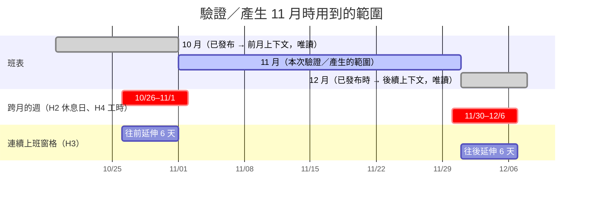
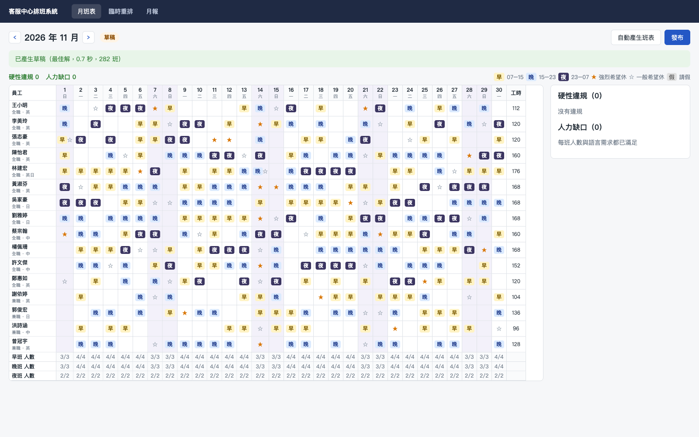
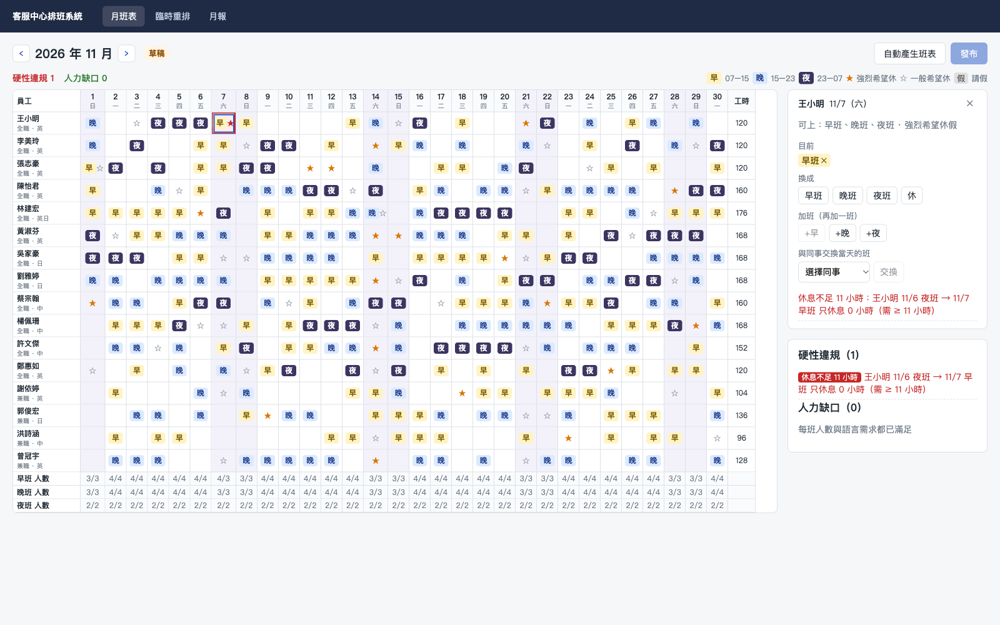
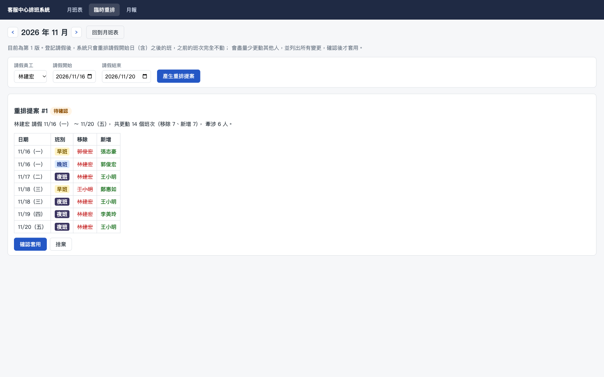
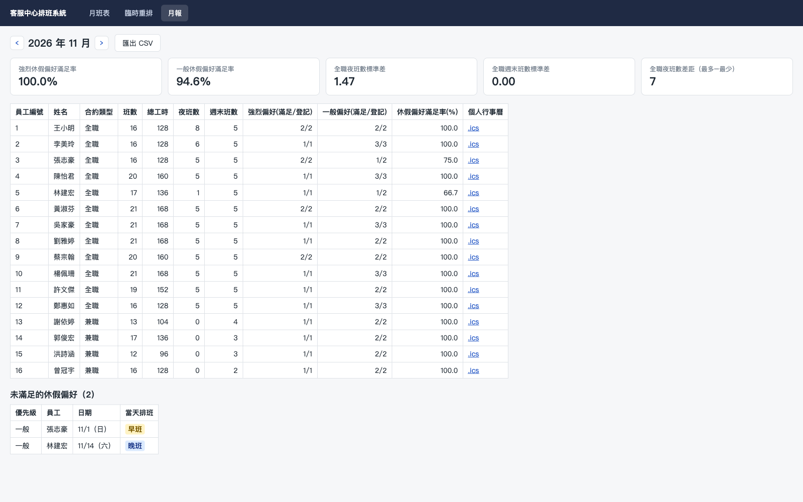

# 客服中心智慧排班系統（Shift Planner）

[](https://github.com/hn83320589/Shift-Planner/actions/workflows/ci.yml)
[](LICENSE)

24 小時客服中心（16 人、早／晚／夜三班）的月班表系統：自動產生符合勞基法限制的班表，
主管可在網頁上手動調整並即時看到違規，發布後遇到臨時請假可只重排受影響的日期。

- .NET 10（LTS）／ASP.NET Core／Blazor Interactive Server
- EF Core 10 + SQLite（含 migration）
- Google OR-Tools CP-SAT 求解
- xUnit，共 116 個測試；CI 在 Ubuntu 與 Windows 上執行

**亮點**：CP-SAT 建模、可解釋的無解診斷、最小變動的臨時重排、產生器與 Validator 兩套實作交叉檢查、勞基法限制的跨月雙向處理。

📘 想了解這個系統是怎麼分析、設計與實作的？請看 [教學文件](docs/tutorial/README.md)。

---

## 啟動方式

需求：[.NET 10 SDK](https://dotnet.microsoft.com/download)。不需要 Docker 或資料庫伺服器。

```bash
git clone https://github.com/hn83320589/Shift-Planner.git
cd Shift-Planner
dotnet run --project src/ShiftPlanner.Web
```

開啟終端機顯示的網址（預設 `http://localhost:5xxx`），進入「月班表」即可。

第一次啟動時會自動：

1. 套用 migration，建立 `src/ShiftPlanner.Web/shiftplanner.db`
2. 載入範例資料：16 位員工、人力需求、2026 年國定假日、11 月休假偏好
3. 用產生器產生 **2026 年 10 月班表並發布**（作為 11 月的前月上下文）

想重新開始時，刪掉 `shiftplanner.db` 再啟動即可。

```bash
dotnet test           # 執行全部測試
```

### 操作流程

1. **月班表** `/schedule/2026/11`：按「自動產生班表」→ 約 1 秒完成 → 零違規
2. 點任一格可換班、加班、刪班、與同事交換；每次修改立即存成草稿並重新驗證
3. 違規格子標紅、側欄列出規則與原因；有任何違規或人力缺口時「發布」停用
4. **臨時重排** `/reschedule/2026/11`：選員工與請假區間 → 檢視更動清單 → 確認套用
5. **月報** `/reports/2026/11`：公平性指標、每人統計、未滿足偏好、CSV 與個人 `.ics` 下載

---

## 專案結構

```
src/
  ShiftPlanner.Core/          純領域邏輯，不依賴任何框架
    Domain/                   Employee、Assignment、Schedule（發布鎖定）、ShiftCatalog…
    Validation/               ★ 獨立的 Validator：7 條硬性規則 + 人力缺口
    Calendar/                 國定假日 JSON 匯入、StaffingCalendar（平日／假日需求）
    Reporting/ Export/        月報、CSV、iCalendar
  ShiftPlanner.Scheduling/    CP-SAT 模型、產生器、無解診斷、臨時重排
  ShiftPlanner.Data/          EF Core DbContext、Migrations、範例資料
  ShiftPlanner.Web/           Blazor 頁面、Minimal API、應用層服務
tests/
  ShiftPlanner.Core.Tests/        74 個：Validator 規則（含跨月雙向）、假日、Schedule、報表、CSV、ICS
  ShiftPlanner.Scheduling.Tests/  19 個：產生、公平性、偏好、無解原因、臨時重排、跨月
  ShiftPlanner.Web.Tests/         23 個：WebApplicationFactory 整合測試（發布鎖定與順序、API、匯出）
data/holidays-2026.json       2026 年台灣國定假日
docs/architecture.md          開發前的系統分析與架構設計
docs/test-report.md           驗收測試報告
docs/tutorial/                教學文件：系統分析、架構、核心演算法、測試策略（12 章）
```

依賴方向：`Web → Scheduling / Data → Core`。Validator 在 Core，產生器在 Scheduling，**兩者是分開的實作**。產生器的結果一定會再交給 Validator 檢查；兩邊結論不一致就直接拋出例外，視為程式錯誤。

---

## 限制的定義與邊界

所有時間都是台北時間（UTC+8，沒有日光節約時間）。**班次歸屬於開始的那一天**：「11/14 夜班」指 11/14 23:00 到 11/15 07:00。

| 班別 | 時間 | 工時 |
|---|---|---|
| 早班 | 07:00–15:00 | 8h |
| 晚班 | 15:00–23:00 | 8h |
| 夜班 | 23:00–隔天 07:00 | 8h |

### 硬性限制（違反就不能發布）

| 規則 | 定義 | 邊界 |
|---|---|---|
| **H1 休息 11 小時** | 同一人相鄰兩班：`下一班開始 − 上一班結束 ≥ 11h`，用實際時間區間計算 | 違規的組合有三種：晚班→隔天早班（8h）、夜班→隔天早班（0h）、夜班→隔天晚班（8h）。三種固定班別的合法組合最短是 16 小時，所以「剛好 11 小時」的邊界改用自訂班別時間來測試（11h 合法、10h59m 違規） |
| **H2 每週 2 天不排班** | 週一到週日之間，至少 2 天**沒有任何班次開始** | 夜班只算開始那天，所以週日上夜班時，週一仍算不排班日。跨月的週會合併前後月份一起算；下個月還沒確定時，只要求 `max(0, 2 − 未知天數)` 天（見下方「跨月處理」） |
| **H3 連續上班 ≤ 6 天** | 連續「有班次開始」的日期不超過 6 天 | 會接上前、後月份已發布的班表一起算（例如 10/27–31 加上 11/1–2 共 7 天就違規）。只在其他月份內部的違規不列入本月 |
| **H4 每週工時 ≤ 上限** | 週一到週日：班數 × 8h ≤ 個人上限 | 夜班的工時算在開始日所在的那一週。兼職 24h 上限：3 班合法，4 班違規 |
| **H5 可上班別** | 只能排在員工可上的班別 | — |
| **H6 每天一班** | 同一人同一個開始日期最多一班 | 夜班加上隔天的班屬於不同日期，不算違反這條，改由 H1 處理 |
| **H7 請假日不排班** | 請假區間內（含頭尾）不可排班 | 這條是臨時重排需要的 |

### 跨月處理（雙向）

2026/11/1 是週日，10/26–11/1 這一週橫跨 10、11 月；11/30 是週一，11/30–12/6 這一週橫跨 11、12 月。H1 到 H4 都可能跨月，所以 Validator、產生器、臨時重排都會帶入**前後月份已發布的班表**當作唯讀上下文：



- **前月上下文**：11/1 早班會檢查 10/31 是否上夜班（H1）；10/26–11/1 這週的休息日與工時包含 10 月的 6 天（H2、H4）。
- **後續上下文**：12 月已發布時，11/30 夜班會檢查 12/1 是否上早班；11/30–12/6 這週也會把 12 月的 6 天算進去。12 月尚未發布時，那 6 天視為未知，11 月只需休 `max(0, 2 − 6) = 0` 天，剩下的留給 12 月補。
- **只採用已發布的月份**：草稿還會變動，不能拿來限制別的月份。
- **強制依序發布**：上個月已建立但還是草稿時，本月不能發布（畫面會說明原因）。否則下個月可能在本月定案前就被發布，之後也不會再被回頭檢查。
- **重排保護下個月**：重排本月時把已發布的下個月當作常數，套用前也會以重排後的本月為上下文，重新驗證下個月。
- **月底不完整的週預留休息日**：只要求 `max(0, 2 − 未知天數)` 天的規則是貪婪的。如果太多人在 10/26–10/31 只休 1 天，他們 11/1 都必須休假，11 月第一天就可能排不出人。所以目標函數對「把休假推給下個月」加上小成本；萬一還是無解，預檢會直接說出「有幾人因上個月月底的排班當天必須休假」。

### 人力需求（缺口也不能發布）

| | 早 | 晚 | 夜 |
|---|---|---|---|
| 平日 | 4 | 4 | 2 |
| 假日（週六日、國定假日、補假） | 3 | 3 | 2 |

- 每一班至少要有 1 位會英文的人；**平日**的早班和晚班另外至少要有 1 位會日文的人（國定假日當天不需要日文）。
- 判斷順序：先看行事曆有沒有登錄這一天，有的話依 `isHoliday` 決定（支援補班日）；沒有登錄的話，週六日算假日、其他算平日。
- `StaffingOverrides` 可以覆寫單一天某一班的需求人數（驗收 #6 用它來製造無解）。

國定假日的資料來源是行政院人事行政總處的 115 年辦公日曆表，包含補假，例如 10/26 光復節補假。2026 年起已經沒有補班日；**11 月沒有國定假日**，所以假日套用的單元測試用 10/26。

### 軟性偏好與公平性指標

- 休假偏好分「強烈」和「一般」兩級。滿足 = 那一天沒有被排班。
- 公平性只計算**全職**員工（兼職不列入，但仍受所有硬性限制約束）：
  - 夜班數、週末班數的**母體標準差**
  - 夜班數差距（最多 − 最少），只看可上夜班的全職員工
- 週末班 = 開始日為週六或週日的班（國定假日不算週末班，避免和「假日人力需求」的定義混在一起）。

---

## 排班建模方式（CP-SAT）

**為什麼選 CP-SAT**：它可以**證明**無解（區域搜尋做不到），重排時只要加上 hint 和「最小差異」目標就能直接共用同一個模型。16 人 × 30 天 × 3 班只有 1,440 個布林變數，範例資料求到最佳解約 1 秒。

### 變數

`x[e,d,s] ∈ {0,1}`：員工 e 是否在 d 日上 s 班。**只為「可上該班別且當天沒請假」的組合建立變數**，所以 H5、H7 不需要另外寫限制。

### 限制

| 對應 | 限制式 |
|---|---|
| H6 | `Σ_s x[e,d,s] ≤ 1` |
| H1 | 從 `ShiftCatalog` 推導出休息不足的（前一班, 隔 k 天的後一班）組合，對每組加上 `x[e,d,s₁] + x[e,d+k,s₂] ≤ 1`；另一班落在前後月份的上下文時，直接把 `x = 0` |
| H2 | 每一週：`Σ 上班日 ≤ 已知天數 − 需休天數`，前後月份的日子代入常數 |
| H4 | 每一週：`Σ x · 分鐘數 ≤ 上限 × 60` |
| H3 | 任意連續 7 天：`Σ 上班日 ≤ 6`（窗格可以往前、往後延伸到其他月份已知的範圍） |
| 人力 | `Σ_e x[e,d,s] ≥ 需求`；技能：`Σ_{e 會該語言} x ≥ 1` |
| 公平性 | 可上夜班的全職員工：`max(夜班數) − min(夜班數) ≤ 2`（產生時是硬限制，對應驗收 #11） |

### 目標函數（最小化）

| 項目 | 權重 |
|---|---|
| 強烈休假偏好被排班 | 1000／筆 |
| 一般休假偏好被排班 | 100／筆 |
| 全職週末班數差距（max − min） | 50 |
| 全職夜班數差距（max − min） | 20 |
| 月底不完整的週，每把 1 天休假推給下個月 | 30（低於一般偏好，不會為此犧牲員工偏好） |
| 每排一班 | 1（需求是「最低」人數，避免無謂地多排） |
| 臨時重排：每個和原班表不同的格子 | 500 |

求解參數：8 個 worker，上限 30 秒（`GenerationRequest.TimeLimit`）。範例資料的結果：11 月 282 班（剛好等於需求）、全職夜班數差距 ≤ 2、強烈偏好滿足率 100%。

**結果不保證每次相同**：8 個 worker 平行搜尋時，同一份輸入可能得到不同的最佳解，目標函數值相同但班次不同。所以測試檢查的是性質，例如零違規、差距 ≤ 2，而不是班表內容。如果需要「重新產生結果完全相同」，要把 `num_workers` 設為 1 並固定 `random_seed`，代價是求解較慢。

求解耗時透過注入的 `TimeProvider` 計算；CP-SAT 內部的時間上限則由原生程式庫自行計時，無法由 .NET 的 `TimeProvider` 控制。

---

## 無解原因的產生方式

CP-SAT 只會告訴我們 `INFEASIBLE`，所以原因分兩層找：

1. **靜態預檢**（`FeasibilityPrecheck`，不需要求解器）
   - 逐格計算可排人數，條件是可上該班別、當天沒請假、不會和前後月份的上下文違反休息規定。不足就回報：
     > 11/14 夜班需要 20 人，但可上夜班、未請假且不違反休息規定的只有 13 人
   - 技能也用同樣方式檢查（例如「需要 1 位會英文的人員，但……只有 0 位」）。
   - 每天的總需求人數，和當天能上班的人數比較。前後月份的排班可能讓某些人當天必須休假（跨月的週休息日、連續上班、週工時），這時會說出人數與原因：
     > 11/1 共需要 8 人上班，但只有 6 人可排，其中 10 人因上個月月底的排班當天必須休假（每週休息日、連續上班或週工時限制）
   - 完整落在當月的每一週：比較總需求班數，和全體員工在工時、休息日、請假限制下最多能上的班數。
2. **彈性診斷模型**（`InfeasibilityDiagnoser`）：預檢通過但仍然無解時使用（例如休息規定造成的連鎖效應）。做法是在每一條人數或技能需求加上 slack 變數，最小化補不滿的總人數，再列出 slack > 0 的格子。訊息格式如下：
   > 11/11 早班需要 5 人，在休息、連續上班與工時限制下最多只能排 4 人

   如果需求全部排得滿，代表無解是「夜班差距 ≤ 2」這條限制造成的，也會明確說出來。

UI 和 API（422 回應的 `reasons`）都會列出每一條原因，包含日期、班別、需要人數與可用人數。

---

## 臨時重排的策略

情境：已發布的 11 月班表中，某人從 11/16 起請假 5 天。

1. **凍結**：請假開始日之前的班次、前月班表，以及已發布的下個月全部當作常數，只重新求解「請假開始日 → 月底」。所以 11/16 之前的班次**不可能**被更動，而不只是剛好沒動到；月底的更動也不會和下個月衝突。
2. **最小更動**：把原班表當作 Baseline，每個和原班表不同的格子成本是 500，並把原班表當作求解起點（hint）。
3. **公平性**：統計期間是整個月，凍結的部分也算進去。夜班差距在重排時只是軟性目標；如果設成硬限制，為了重新平衡會牽動更多人。
4. **提案 → 確認**：結果存成 `RescheduleProposal`（狀態待確認），列出每一格移除和新增的人，這時班表完全不變。主管確認之後才會：
   - 登記請假
   - 重新驗證本月（包含這次的新請假與下個月開頭），並重新驗證已發布的下個月
   - 套用變更，班表版本 +1

   如果提案產生之後班表又被改過（版本不同），舊提案會被拒絕。
5. 不能重排今天（依台北時間，透過 `TimeProvider` 判斷）以前的日期。

測試證明：11/16 之前的班次集合完全相同、整月零違規、請假者在請假期間沒有班，而且更動數量遠少於整段重新產生。

---

## 發布與不可變

- `Schedule` 領域物件發布後，`Add / Remove / ReplaceAll / Publish` 都會丟出 `ScheduleLockedException`。只有 `ApplyRevision`（臨時重排）可以更新，而且仍然要驗證通過。
- 頁面和 API 都經過同一個 `ScheduleService`，沒有繞過的路徑。API 對已發布班表的任何修改都回傳 **409**。
- 發布前會重新驗證：硬性違規**或**人力缺口任何一項不為零，就回傳 **422** 並附上清單。
- 必須依序發布：上個月已建立但還是草稿時，回傳 **400** 並說明要先發布上個月。

### API 一覽

| 方法 | 路徑 | 說明 |
|---|---|---|
| GET | `/api/schedules/{y}/{m}` | 班表、違規、缺口、能否發布 |
| POST | `/api/schedules/{y}/{m}/generate` | 產生草稿（無解時回傳 422 與原因） |
| POST / PUT / DELETE | `/api/schedules/{y}/{m}/assignments` | 加班／換班／刪班 |
| POST | `/api/schedules/{y}/{m}/publish` | 發布 |
| POST | `/api/schedules/{y}/{m}/reschedule-proposals` | 產生臨時重排提案 |
| POST | `/api/reschedule-proposals/{id}/apply`、`/discard` | 套用／捨棄提案 |
| GET | `/api/reports/{y}/{m}`、`/export.csv` | 月報（JSON／CSV） |
| GET | `/api/employees/{id}/schedules/{y}/{m}/calendar.ics` | 個人班表（只限已發布） |

### 匯出格式

- **CSV**：UTF-8 **含 BOM**，Excel 直接開啟中文不會亂碼。換行是 CRLF，引號依 RFC 4180。
  - 除了姓名和合約類型，每一欄都是純數字。偏好統計拆成「滿足數」「登記數」兩欄，因為 `2/2` 這類字串會被 Excel 自動轉成日期。
  - 畫面表格和 CSV 由同一個 `MonthlyReportCsv.Cells` 產生，有整合測試逐列比對，也已用 Microsoft Excel 實際開啟驗證。
- **ICS**：自行產生，沒有引入套件，遵循 RFC 5545。
  - 時間用 `DTSTART;TZID=Asia/Taipei` 表示，並附上 `VTIMEZONE` 定義；夜班的 `DTEND` 是隔天 07:00。
  - UID 由員工、日期、班別組成，重新匯入 Google 日曆時會更新既有事件，不會重複。
  - 每行以 UTF-8 位元組為單位折到 75 octets 以內，不會切斷中文字。

---

## 畫面截圖

**月班表**（自動產生後零違規、零缺口；底部列出每班人數／需求）



**違規標示**（把夜班隔天的人手動排早班：格子標紅、側欄說明原因、發布按鈕停用）



**臨時重排確認**（林建宏 11/16–11/20 請假：列出所有被更動的班次，確認後才套用）



**月報**（公平性指標、每人統計、未滿足偏好、CSV 與 .ics 下載）



---

## 驗收對照

| # | 驗收項目 | 測試 |
|---|---|---|
| 1 | `dotnet run` 自動建庫並載入範例資料 | `DatabaseTests`、`ScheduleApiTests.啟動後10月班表已發布且零違規` |
| 2 | 11 月 60 秒內產生、零違規 | `ShiftScheduleGeneratorTests.範例資料產生11月班表_60秒內完成且validator零違規` |
| 3 | 每條硬性限制都有違反與剛好不違反的測試 | `Core.Tests/Validation/*RuleTests` |
| 4 | 夜→早（0h）、晚→早（8h）判定違規 | `RestPeriodRuleTests` |
| 5 | 國定假日套用假日人力 | `StaffingCalendarTests.國定假日補假落在週一_套用假日人力需求` |
| 6 | 無解原因包含日期、班別、人數 | `InfeasibilityDiagnosisTests.夜班需求超過可排人數_…` |
| 7 | 違規時無法發布，修正後可以 | `ScheduleApiTests.手動排出違規_標示違規且無法發布_修正後可以發布` |
| 8 | 已發布班表無法經由頁面或 API 修改 | `ScheduleTests.發布後…`、`ScheduleApiTests.已發布的班表_…409…`、`ScheduleServiceTests.已發布班表無法交換` |
| 9 | 11/16 起請假 5 天，之前完全不變 | `ReschedulerTests`、`RescheduleApiTests` |
| 10 | 強烈偏好滿足率 ≥ 90%，並列出未滿足項目 | `ShiftScheduleGeneratorTests.強烈休假偏好滿足率達90百分比以上`、`MonthlyReportTests` |
| 11 | 全職夜班差距 ≤ 2 | `ShiftScheduleGeneratorTests.全職員工之間的夜班數差距不超過2` |
| 12 | ICS 夜班結束在隔天 07:00、台北時區 | `ICalendarWriterTests` |
| 13 | CSV 中文不亂碼，數字與畫面一致 | `MonthlyReportCsvTests`（含「數值欄位都是純數字」）、`ReportApiTests` |
| 14 | 至少 30 個單元測試 | 單元測試 93 個，加上整合測試共 116 個 |

完整的測試方法、端對端驗證與缺陷修正紀錄見 [docs/test-report.md](docs/test-report.md)。

CI：`.github/workflows/ci.yml` 在 Ubuntu 與 Windows 上執行 restore、Release 建置、測試；`dotnet format --verify-no-changes` 只在 Ubuntu 執行。

---

## 範例資料

- **員工**（姓名皆為虛構）：
  - 全職 12 人：40h／週，三班都可以上；會英文 7 人、會日文 3 人（其中 1 人英日文都會）
  - 兼職 4 人：上限 24 或 32h／週，各自只能上部分班別
- **人力需求**：見上表。11 月總需求 282 班。
- **10 月班表**：啟動時由產生器產生並發布（10 月有國慶日補假與光復節補假，會用到假日需求）。
- **11 月休假偏好**：20 筆強烈、37 筆一般。11/14（六）刻意集中多人登記，製造競爭。

---

## 已知限制

- **休息日以班次開始日判定**：夜班的人隔天早上 07:00 才下班，那天仍算「不排班日」。沒有區分勞基法的例假與休息日，也沒有檢查「連續 24 小時休息」。
- **下個月還沒發布時，跨月的週只檢查已知天數**：例如 11/30–12/6 這週，12 月發布前只檢查 11/30；12 月產生與發布時，會以 11 月為上下文完整檢查。
- **重排後夜班可能變得不平均**：重排以最少更動為優先，夜班差距只是軟性目標。請假者的夜班數會下降，代班的人也可能集中，所以重排後月報上的夜班差距可能超過 2（實測一次 11/16–20 請假後為 7）。這是「少動別人」與「重新平衡」之間的取捨。
- **最低人數就是排班人數**：每排一班有微小成本，所以產生器剛好排到最低人數，全職員工不一定每週都排滿 40 小時。
- **ICS 的 UID 由員工＋日期＋班別組成**：同一天改了班別，重新匯入 Google 日曆時舊事件不會自動刪除。
- **只有已發布的月份會當作上下文**：前月還是草稿時，可以先產生本月草稿，但跨月限制要等前月發布後才會檢查，本月也必須等前月發布後才能發布。
- 依題目假設，只有一位主管使用，不處理登入、權限與多人同時編輯。
- 求解有 30 秒上限：資料規模遠大於 16 人時，可能只得到可行解而非最佳解（畫面會標示「可行解」）。
