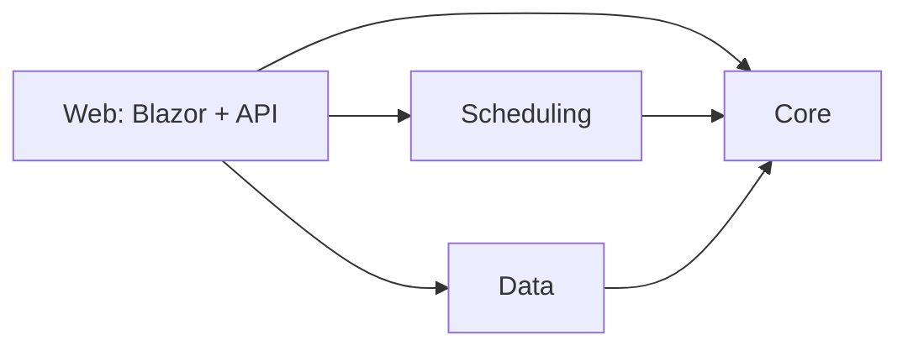

# Shift Planner — 系統分析與架構設計（v0.2）

> 狀態：架構決策已確認，尚未開始開發。

## 0. 已確認的決策

| 項目 | 決定 |
|---|---|
| UI | Blazor Web App，Interactive Server 模式 |
| 求解器 | Google OR-Tools CP-SAT（NuGet `Google.OrTools`） |
| 發布閘門 | 硬性違規**與**人力缺口（人數、技能）都會擋發布 |
| Target framework | `net10.0`（LTS） |

---

## 1. 領域分析

### 1.1 核心名詞

| 名詞 | 說明 |
|---|---|
| Employee | 客服人員：合約類型（全職/兼職）、每週工時上限、語言技能（中/英/日，可複選）、可上班別 |
| ShiftType | 固定三種：Early 07–15、Late 15–23、Night 23–07（+1 日）。每班 8 小時 |
| Assignment | 「某人、某日、某班」。**日期 = 班次開始日**（11/14 夜班 = 11/14 23:00 → 11/15 07:00） |
| DayType | `Weekday` / `Holiday`。週六、週日、國定假日（含補假）為 Holiday；補班日為 Weekday |
| StaffingRequirement | (DayType, ShiftType) → 最低人數；另有「單日覆寫」(Date, ShiftType) → 人數，給驗收 #6 使用 |
| SkillRequirement | (DayType, ShiftType, Skill) → 最少人數。預設：每班英文 ≥ 1；Weekday 的 Early/Late 日文 ≥ 1 |
| Leave | 主管登記的請假（日期區間），屬於**硬性**不可排班 |
| OffPreference | 員工希望休假日，優先級為 Strong / Normal，屬於**軟性** |
| Schedule | 某月班表，狀態 `Draft` → `Published`，發布後只能走「臨時重排」流程產生新版本 |

### 1.2 硬性限制的精確定義與邊界

所有規則都以**時間區間**計算，不寫死班別組合。這樣規則本身比較好測試，也容易解釋。

| # | 規則 | 定義 | 邊界 |
|---|---|---|---|
| H1 | 11 小時休息 | 同一人相鄰兩班：`next.Start − prev.End ≥ 11h` | 實際會違規的組合：晚→隔天早（8h）、夜→隔天早（0h）、夜→隔天晚（8h）。合法組合的最小間隔是 16h |
| H2 | 每週 2 天不排班 | 週一到週日，「沒有任何班次**開始**」的日期 ≥ 2 天 | 夜班只算開始那天。月底不完整的週：要求天數 = `max(0, 2 − 月份範圍外的天數)` |
| H3 | 連續上班 ≤ 6 天 | 連續「有班次開始」的日期 ≤ 6 | 往前會接上個月已發布的班表（10 月）一起算 |
| H4 | 每週工時 ≤ 上限 | 週一到週日，班數 × 8h ≤ 個人上限 | 夜班工時算在開始日所屬的那一週 |
| H5 | 可上班別 | Assignment 的班別 ∈ 員工可上班別 | — |
| H6 | 每天一班 | 同一人同一日期最多 1 筆 Assignment | 夜班加隔天早班不算這條，由 H1 處理 |
| H7 | 請假日不排班 | Leave 區間內不可有 Assignment | 題目沒有明列，但臨時重排需要它 |

**跨月處理**：2026/11/1 是週日，所以「10/26–11/1」這一週會跨月。Validator 與產生器都會載入**前一個月已發布的班表當作固定的上下文**（只讀不改），H1–H4 才能在月初正確判斷。

**人力缺口**（另一類結果，和硬性違規分開列）：
- 某 (日期, 班別) 人數 < 最低人數
- 某 (日期, 班別) 會英文/日文的人數 < 需求

### 1.3 軟性偏好與公平性指標

- 休假偏好滿足率 = 該日沒有被排班的偏好數 ÷ 偏好總數，Strong 與 Normal 分開計算。
- 夜班數、週末班數的標準差：只計算**全職**員工，用母體標準差。
- 週末班 = 開始日為週六或週日的班（國定假日不算，避免和「假日人力需求」的定義混在一起）。
- 夜班差距（最多 − 最少）：在**可上夜班的全職**員工之間計算。

---

## 2. 架構

### 2.1 專案結構

```
ShiftPlanner.sln
src/
  ShiftPlanner.Core/          # 純領域：實體、規則、Validator、報表、ICS、CSV（不依賴 EF / OR-Tools）
  ShiftPlanner.Scheduling/    # 產生器、臨時重排、無解診斷（依賴 Core + Google.OrTools）
  ShiftPlanner.Data/          # EF Core DbContext、Migrations、Seeder、Repository
  ShiftPlanner.Web/           # ASP.NET Core：Blazor UI + Minimal API + DI 組裝
tests/
  ShiftPlanner.Core.Tests/        # Validator、假日、ICS、CSV、指標
  ShiftPlanner.Scheduling.Tests/  # 產生、無解原因、重排、公平性
  ShiftPlanner.Web.Tests/         # WebApplicationFactory：發布後不可改、發布閘門
data/
  holidays-2026.json
```



**關鍵原則**：`Core` 不依賴任何框架。Validator 是一個純函式：`Validate(ScheduleSnapshot) → ValidationResult`。產生器的輸出也一定會再跑一次 Validator 當作最後檢查，等於有兩套獨立的實作互相驗證。

### 2.2 Validator 設計

```csharp
public sealed record ScheduleSnapshot(
    DateRange Horizon,                       // 要驗證的範圍（例如 11/1–11/30）
    IReadOnlyList<Employee> Employees,
    IReadOnlyList<Assignment> Assignments,   // Horizon 內
    IReadOnlyList<Assignment> Context,       // 前月已發布、唯讀
    IReadOnlyList<Leave> Leaves,
    IStaffingCalendar Calendar);             // 解析日期的 DayType 與需求人數

public interface IHardRule { IEnumerable<Violation> Check(ScheduleSnapshot s); }
// RestPeriodRule, WeeklyDaysOffRule, ConsecutiveDaysRule, WeeklyHoursRule,
// AllowedShiftRule, OnePerDayRule, LeaveRule
// CoverageChecker → CoverageGap（人數 / 技能）
```

每條規則各自一個 class，各自測試。`Violation` 會帶 `RuleCode`、`EmployeeId`、`Date`、`ShiftType`、中文訊息，UI 用這些資訊在格子上標示。

### 2.3 產生器建模（CP-SAT）

- **變數**：`x[e,d,s] ∈ {0,1}`，代表員工 e 在 d 日上 s 班。規模 16 × 30 × 3 = 1,440 個布林變數。
- **硬限制**：
  - H5、H7：不可上的組合直接不建立變數
  - H6：`Σ_s x[e,d,s] ≤ 1`
  - H1：`x[e,d,Late] + x[e,d+1,Early] ≤ 1`、`x[e,d,Night] + x[e,d+1,Early] ≤ 1`、`x[e,d,Night] + x[e,d+1,Late] ≤ 1`。月初會用 10 月的上下文當常數
  - H2、H4：每週加總，跨月的週代入上下文
  - H3：任意連續 7 天的上班日數 ≤ 6
  - 需求：`Σ_e x[e,d,s] ≥ req(d,s)`；技能：`Σ_{e∈EN} x ≥ 1` 等
  - 公平性：全職可上夜班者的夜班數 `max − min ≤ 2`
- **目標函數**（加權，數字越小越好）：
  `1000·Strong偏好違反 + 100·Normal偏好違反 + 50·(週末班 max−min) + 20·(夜班 max−min)`
- 時間上限 30 秒，8 個 worker。預期幾秒內就能找到最佳解或接近最佳的解。
- 求解完成後跑 Validator，結果有違規就視為 bug，直接拋出錯誤（fail fast）。

### 2.4 無解原因的產生（兩層）

1. **靜態預檢**（不需要求解器）：對每個 (d, s) 計算候選人數，條件是可上該班、沒請假、不會和前月上下文違反休息規定。候選人數 < 需求時，產生
   `「11/14 夜班需要 3 人，但可上夜班且不違反休息規定的只有 2 人」`。技能也照同樣方式檢查，另外還會檢查每週總需求和總產能。
2. **彈性模型**：預檢通過，但 CP-SAT 判定 INFEASIBLE 時，替每條需求與技能限制加上 slack 變數，最小化 Σslack 後重新求解，把 slack > 0 的格子列出來：
   `「11/20 早班需要 4 人，在休息/連續上班/工時限制下最多只能排 3 人」`。

### 2.5 臨時重排策略

輸入：已發布班表、員工、請假起訖日（例如 11/16–11/20）。

1. 日期 `< 11/16` 的所有 Assignment 加上前月上下文，全部當常數凍結。
2. 請假員工在請假區間內的變數不建立。
3. 目標函數 = `1000·Σ|x − x_orig|`（盡量少更動）+ 原本的軟性目標。原解當作 solution hint。
4. 輸出差異清單：每一筆標示新增或移除，含日期、班別、員工。存成 `RescheduleProposal(Pending)`。
5. 主管確認後套用。班表仍為 Published，`Revision + 1`，並記錄變更歷史。

測試會證明：套用前後，日期 < 11/16 的 Assignment 集合完全相同，而且 Validator 結果為零違規。

### 2.6 發布與不可變

- 領域層：`Schedule.AddAssignment/Remove/Swap` 在 `Status == Published` 時拋出 `ScheduleLockedException`。
- API 層：對已發布的班表做修改會回傳 `409 Conflict`。Web.Tests 會用 `WebApplicationFactory` 驗證。
- 發布閘門：`Publish()` 前重新執行 Validator，有硬性違規就拒絕；人力缺口也一律擋。

### 2.7 資料模型（EF Core + SQLite）

```
Employees(Id, Name, ContractType, WeeklyHourLimit, Skills[flags], AllowedShifts[flags])
Holidays(Date PK, Name, IsHoliday)                 -- IsHoliday=false 代表補班日
StaffingRequirements(DayType, ShiftType, MinStaff)
StaffingOverrides(Date, ShiftType, MinStaff)
SkillRequirements(DayType, ShiftType, Skill, MinCount)
Leaves(Id, EmployeeId, StartDate, EndDate)
OffPreferences(Id, EmployeeId, Date, Priority)
Schedules(Id, Year, Month, Status, Revision, PublishedAt)
Assignments(Id, ScheduleId, EmployeeId, Date, ShiftType)
RescheduleProposals(Id, ScheduleId, EmployeeId, LeaveStart, LeaveEnd, Status, CreatedAt)
ProposalChanges(Id, ProposalId, Kind, EmployeeId, Date, ShiftType)
```

> Assignments 的 unique key 刻意不設在 (ScheduleId, EmployeeId, Date)。主管手動「加班」時可能把同一人同一天排兩班，這種違規必須能存進草稿，Validator 才標示得出來。如果交給資料庫擋掉，H6 就永遠測不到真實情境。

啟動時：`Database.Migrate()`，資料庫是空的就執行 Seeder。

### 2.8 Web 介面與 API

| 頁面 | 內容 |
|---|---|
| `/schedule/2026-11` | 月班表格線：列是員工、欄是日期。點格子可以換班、加班、刪班。違規格子標紅並顯示 tooltip，底部列出每班人數與缺口。有「產生」「存草稿」「發布」按鈕 |
| `/reschedule` | 選員工與請假區間 → 預覽差異清單 → 確認套用 |
| `/reports/2026-11` | 每人總工時、夜班、週末班、偏好滿足率、未滿足的偏好清單、公平性指標、下載 CSV |
| `/employees`、`/requirements`、`/preferences` | 基本資料維護（以夠用為原則） |

Minimal API（`/api/...`）提供產生、指派操作、驗證、發布、重排、`.ics`、`.csv`，主要用於整合測試。Blazor 頁面直接呼叫同一組 application service，所以兩條路徑共用同一份商業邏輯。

### 2.9 匯出

- **ICS**：自己產生（RFC 5545），不額外引入套件。包含 `VTIMEZONE: Asia/Taipei`（+08:00，無日光節約）、`DTSTART;TZID=Asia/Taipei`、CRLF、75 octet 折行、穩定的 UID。夜班的 `DTEND` 是隔天 07:00。
- **CSV**：UTF-8 **含 BOM**（Excel 才不會亂碼），數字由產生畫面的同一個 `MonthlyReport` 物件輸出，確保兩邊一致。

### 2.10 TimeProvider

`TimeProvider` 註冊成 singleton。使用的地方包括：預設顯示月份、`PublishedAt`、Proposal 的 `CreatedAt`、ICS 的 `DTSTAMP`，以及「不能重排已經過去的日期」的檢查。測試改用 `FakeTimeProvider`（`Microsoft.Extensions.TimeProvider.Testing`，微軟官方套件）。

---

## 3. 範例資料設計

- **員工 16 人**：
  - 全職 12 人：40h/週，全部可上三班。其中英文 6 人、日文 3 人，兩種都會的 1 人。
  - 兼職 4 人：24–32h/週，各自限制可上班別（例如只上早班、只上早/晚班）。另有 1 位兼職會日文。
- **人力需求（草案）**：

  | 班別 | 平日 | 假日 |
  |---|---|---|
  | 早班 | 4 | 3 |
  | 晚班 | 4 | 3 |
  | 夜班 | 2 | 2 |

  11 月共 21 個平日、9 個假日，總需求 282 班。產能約為全職 12 × 5 + 兼職 14 ≈ 74 班/週，大於需求 66 班/週，留有餘裕給休假偏好。
- **國定假日**：2026 年台灣（人事行政總處公告），開發時會逐筆核對。**11 月沒有國定假日**，所以國定假日的單元測試會用其他日期（例如 10/26 光復節補假）。
- **10 月已發布班表**：由 Seeder 呼叫產生器產生、通過 Validator 後標記為 Published，作為 11 月的上下文。
- **11 月休假偏好**：每人 1–2 個 Strong、2–3 個 Normal，並刻意讓部分日期有衝突，報表才會出現未滿足的項目。

---

## 4. 驗收對應

| 驗收 | 由誰保證 |
|---|---|
| 1 | Program 啟動時 Migrate + Seed |
| 2 | Scheduling.Tests：11 月產生 < 60s 且 Validator 零違規 |
| 3, 4 | Core.Tests：每條規則各有違規與剛好不違規兩個案例（H1 另外用自訂班別時間測「剛好 11h」） |
| 5 | Core.Tests：StaffingCalendar 假日解析 |
| 6 | Scheduling.Tests：Override 夜班 = 20 → 訊息含日期、班別、需求人數、可用人數 |
| 7 | Web.Tests：寫入違規 → 發布失敗；修正後 → 發布成功（加上截圖） |
| 8 | Core.Tests（領域例外）+ Web.Tests（409） |
| 9 | Scheduling.Tests：11/16 前的集合相等、零違規、差異清單非空 |
| 10, 11 | Scheduling.Tests：滿足率 ≥ 90%、夜班差距 ≤ 2 |
| 12 | Core.Tests：ICS 內容比對 |
| 13 | Core.Tests：BOM 開頭 + 數字與 MonthlyReport 一致 |
| 14 | 預估約 45 個測試 |

---

## 5. 已知限制（預計寫進 README）

- 「休息日」以班次開始日判定。夜班隔天早上 07:00 才下班，那天仍然算作不排班日，沒有區分勞基法的例假與休息日，也沒有檢查 24 小時連續休息。
- 月底不完整的週只檢查已知的天數。下個月排班時，再以本月為上下文補齊檢查。
- 單一主管、沒有並行控制、沒有登入機制。
