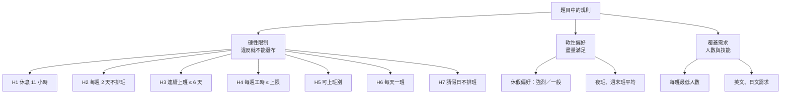

# 第 1 章　需求分析：從題目到可測試的規格

> 本章目標：學會把一段自然語言需求拆解成**名詞、規則、邊界與驗收標準**，並在寫任何程式碼之前，先把「會吵架的地方」定義清楚。

---

## 1.1 為什麼需求分析是最重要的一步

排班題目看起來很直白：「兩班之間至少間隔 11 小時」「每週至少 2 天不排班」。但只要多問一句，就會發現每條規則背後都藏著沒說清楚的地方：

| 題目寫的 | 沒說清楚的地方 |
|---|---|
| 每週至少 2 天不排班 | 「一週」從哪天開始？月底只剩 1 天的週怎麼算？ |
| 夜班 23:00–07:00 | 11/14 夜班算 11/14 還是 11/15 的班？會影響「每天一班」「每週工時」 |
| 連續上班不得超過 6 天 | 10 月底連上 4 天，接 11 月初上 3 天，算不算違規？ |
| 每週工時不得超過上限 | 週日開始的夜班，工時算哪一週？ |

這些問題如果到寫程式時才發現，常見的結果是：**產生器和驗證器各自做了不同的假設**，兩邊算出的結果對不起來，卻沒人知道誰對。

本專案的做法是：**在寫任何程式碼之前，先寫一份分析文件**（`docs/architecture.md`），把每條規則的定義和邊界寫成表格，再和需求方確認。

---

## 1.2 步驟一：找出名詞（領域詞彙）

閱讀題目時，把所有名詞圈出來，就是領域模型的候選：

| 名詞 | 說明 | 後來變成 |
|---|---|---|
| 員工 | 合約類型、每週工時上限、語言技能、可上班別 | `Employee` |
| 班別 | 早、晚、夜，時間固定 | `ShiftType` + `ShiftCatalog` |
| 排班（某人某天某班） | 班表的最小單位 | `Assignment` |
| 人力需求 | 每天每班的最低人數，平日假日分開 | `StaffingRequirement` |
| 技能需求 | 每班至少 1 位會英文…… | `SkillRequirement` |
| 國定假日 | JSON 匯入 | `Holiday` |
| 休假偏好 | 強烈／一般 | `OffPreference` |
| 請假 | 主管登記 | `Leave` |
| 班表 | 以月為單位，草稿 → 發布 | `Schedule` |

**技巧**：同時圈出動詞（產生、驗證、發布、重排、匯出），它們通常會變成**服務**或**用例**。

---

## 1.3 步驟二：把規則分類

題目裡的規則性質不同，處理方式也不同：

分類的意義：

- **硬性限制**是「對個人」的規則，違反就是違法或不可能執行。
- **覆蓋需求**是「對整體」的規則，排不滿就是人力缺口。題目沒說缺口能不能發布，這是一個**需要和需求方討論的決策**（本專案決定：缺口也不能發布）。
- **軟性偏好**是最佳化的目標，不是對錯問題。

> **教學重點**：H7「請假日不排班」題目沒有明列，是分析「臨時請假重排」需求時推導出來的。好的需求分析會**補出隱含的規則**。

---

## 1.4 步驟三：定義每條規則的精確邊界

這是本章最重要的部分。以下是本專案最後採用的定義（完整版在 [README](../../README.md#限制的定義與邊界)）：

### 班次歸屬：以「開始日」為準

題目的假設事項寫：「11/14 夜班是 11/14 23:00 到 11/15 07:00」。據此訂出一條全域規則：

> **所有規則中的「日期」都是班次的開始日。**

這條規則一旦訂下，後面很多問題都有了答案：

- 夜班的工時算在開始日所在的那一週（H4）。
- 週日上夜班，週一早上 07:00 才下班，但**週一仍算不排班日**（H2）。
- 11/14 夜班加上 11/15 早班不違反「每天一班」（H6，因為開始日不同），但會違反「休息 11 小時」（H1）。

### 休息 11 小時：用時間區間計算，而不是列舉組合

一種直覺的寫法是列出違規的組合：「晚接早、夜接早、夜接晚」。但更好的定義是：

> 同一人相鄰兩班：`下一班開始時間 − 上一班結束時間 ≥ 11 小時`。

好處：

1. 違規組合可以**由程式推導**，不會漏列。
2. 改了班別時間（例如晚班改成 14:00–22:00），規則不用改。
3. 可以測試「剛好 11 小時」這種邊界。三種固定班別的合法組合最短是 16 小時，根本測不到 11 小時。

| 前一班 → 隔天 | 早 07:00 | 晚 15:00 | 夜 23:00 |
|---|---|---|---|
| 早（15:00 下班） | 16h ✅ | 24h ✅ | 32h ✅ |
| 晚（23:00 下班） | **8h ❌** | 16h ✅ | 24h ✅ |
| 夜（07:00 下班） | **0h ❌** | **8h ❌** | 16h ✅ |

### 每週與跨月：一週是週一到週日

2026/11/1 是**週日**，所以 10/26–11/1 這一週有 6 天在 10 月、1 天在 11 月。驗證 11 月時，如果只看 11 月，這週只有 1 天，「每週休 2 天」根本無從判斷。

因此訂出：

> 驗證某個月時，要帶入**前一個月已發布的班表**當作唯讀上下文。

月底也有相反的問題：11/30 是週一，那一週有 6 天在 12 月。12 月還沒排時，這 6 天是**未知**的，所以只要求 `max(0, 2 − 未知天數)` 天休息。（這條規則後來被發現有陷阱，見[第 8 章](08-cross-month.md)。）

---

## 1.5 步驟四：把驗收標準變成測試

題目附了 14 條驗收標準。好的做法是**每一條都對應到至少一個自動化測試**，而且在開發前就規劃好：

| 驗收 | 內容 | 對應的測試設計 |
|---|---|---|
| #3 | 每種硬性限制都有「違反」與「剛好不違反」的測試 | 每條規則一個測試類別，各有成對的測試 |
| #4 | 夜接早（0h）、晚接早（8h）判定違規 | `RestPeriodRuleTests` 中的具名測試 |
| #6 | 無解原因要有日期、班別、需要人數、可用人數 | 刻意把 11/14 夜班需求設成 20 人 |
| #9 | 11/16 之前的班次完全沒變 | 比對重排前後「日期 < 11/16」的集合是否相等 |
| #11 | 全職夜班數差距 ≤ 2 | 從產生結果計算 max − min |

> **教學重點**：「能被測試」是規格品質的試金石。如果一條需求寫不出測試，通常代表它還不夠精確。

---

## 1.6 步驟五：列出需要決策的問題

分析過程中會遇到「題目沒說、但必須決定」的問題。本專案在開發前列出了這些決策，並和需求方確認：

| 問題 | 選項 | 決定 | 理由 |
|---|---|---|---|
| UI 框架 | Razor Pages / Blazor | Blazor Server | 「每次修改即時重新檢查」在伺服器端重新驗證、重繪最自然 |
| 求解方式 | CP-SAT / 自寫區域搜尋 | CP-SAT | 能**證明**無解；重排可以共用同一個模型 |
| 人力缺口能否發布 | 擋 / 只警告 | 擋 | 最低人數是客戶的底線 |
| 跨月發布順序（後來才決定） | 強制依序 / 不限順序 | 強制依序 | 規則簡單、容易測試，見第 8 章 |

> **教學重點**：把決策**寫下來、附上理由**，六個月後回頭看時，才知道「為什麼當初這樣做」，也知道改的時候會影響什麼。

---

## 1.7 非功能需求

除了功能，題目也有非功能需求，它們同樣會影響設計：

| 非功能需求 | 對設計的影響 |
|---|---|
| 16 人規模 60 秒內完成 | 需要有效率的求解器；也要在測試中量測時間 |
| 時間相關邏輯一律透過 `TimeProvider` 注入 | 所有「今天」「現在」都不能直接呼叫 `DateTime.Now`，才能在測試中控制時間 |
| 驗證邏輯必須是獨立的 validator | 驗證器不能依賴產生器，兩者要能互相檢查 |
| `dotnet run` 自動建庫並載入範例資料 | 啟動時執行 migration 與 seeding |

---

## 本章小結

1. 先圈名詞與動詞，得到領域模型與用例的候選。
2. 把規則分成硬性、覆蓋、軟性三類，處理方式不同。
3. **為每條規則定義精確的邊界**；用「時間區間」這類可計算的定義，取代「列舉情況」。
4. 每條驗收標準都要能對應到自動化測試。
5. 把「題目沒說、但必須決定」的事情列出來，附上理由，和需求方確認。

---

## 練習題

1. 題目說「每週至少 2 天不排班」。如果改成「每 7 天中至少 1 天例假、1 天休息日」（勞基法第 36 條的實際寫法），定義要怎麼改？「任意連續 7 天」和「固定週一到週日」有什麼不同？
2. 若客服中心改成「早班 06:00–14:00、晚班 14:00–22:00、夜班 22:00–06:00」，哪些違規組合會改變？用 1.4 節的表格重新計算。
3. 「休息 11 小時」的規則，本專案只檢查**相鄰**兩班。請說明為什麼不需要檢查不相鄰的兩班（提示：時間區間已排序）。
4. 列出三個你認為題目中「沒說清楚、需要和客戶確認」的地方，並為每一個提出兩個選項與你的建議。
5. ★ 題目假設「每班 8 小時都計入工時，不扣除休息時間」。如果改成「扣除 1 小時休息」，程式中哪些地方要改？（提示：`ShiftCatalog.HoursOf` 與 `WeeklyHoursRule`）
