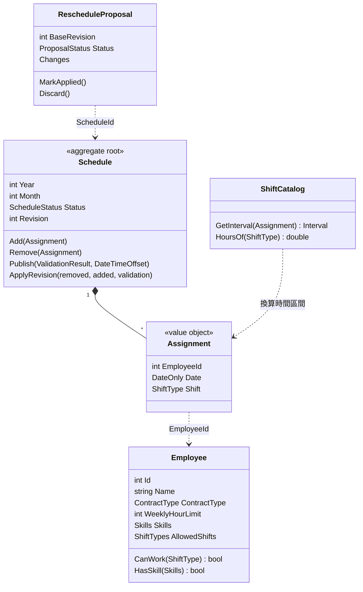
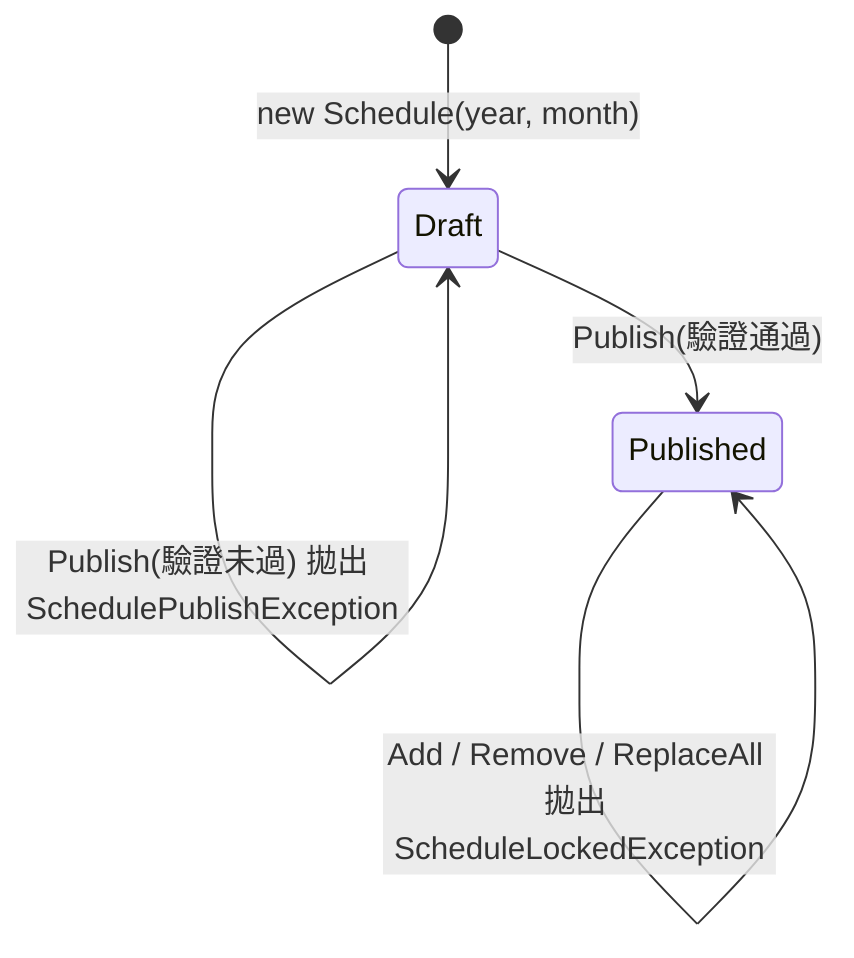

# 第 2 章　領域模型：用型別表達業務規則

> 本章目標：理解實體、值物件、聚合的差別，並學會**讓型別系統替你檢查業務規則**。程式碼位於 `src/ShiftPlanner.Core/Domain/`。

---

## 2.1 領域模型全貌



---

## 2.2 值物件：`Assignment`

```csharp
// src/ShiftPlanner.Core/Domain/Assignment.cs
/// <summary>某人在某日上某班。Date 為班次開始日（夜班歸屬開始那天）。</summary>
public sealed record Assignment(int EmployeeId, DateOnly Date, ShiftType Shift);
```

`Assignment` 沒有 `Id`，因為它是**值物件**：兩個「1 號員工、11/14、夜班」就是同一件事，不需要分辨「第幾筆」。

C# 的 `record` 自動提供**值相等**（value equality），帶來很多便利：

```csharp
var a = new Assignment(1, new DateOnly(2026, 11, 14), ShiftType.Night);
var b = new Assignment(1, new DateOnly(2026, 11, 14), ShiftType.Night);
a == b;                                 // true
schedule.Assignments.Contains(a);       // 用值比較
original.Except(result.Assignments);    // 直接算出「被移除的班」
```

第 7 章的臨時重排就是靠 `Except` 一行算出差異清單。如果 `Assignment` 是帶 Id 的實體，就得自己寫比較邏輯。

> **思考**：那資料庫怎麼存一個沒有 Id 的東西？EF Core 允許「影子屬性」（shadow property）：資料表有 `Id` 欄位，但領域物件看不到。見 `ShiftPlannerDbContext` 的 `OwnsMany(... a.Property<int>("Id"))`。

---

## 2.3 用列舉與 Flags 表達「可複選」

員工的語言技能和可上班別都是**可複選**的。用 `[Flags]` 列舉，一個整數就能存多個選項：

```csharp
// src/ShiftPlanner.Core/Domain/Enums.cs
[Flags]
public enum Skills
{
    None = 0,
    Chinese = 1,
    English = 2,
    Japanese = 4,
}

// 林建宏會中、英、日文
Skills skills = Skills.Chinese | Skills.English | Skills.Japanese;   // 值為 7
```

判斷時用位元運算，包裝在有意義的方法名稱裡：

```csharp
// src/ShiftPlanner.Core/Domain/Employee.cs
public bool CanWork(ShiftType shift) => AllowedShifts.HasFlag(shift.ToFlag());
public bool HasSkill(Skills skill) => (Skills & skill) == skill;
```

> **注意**：`ShiftType`（單選：這一班是哪一種）和 `ShiftTypes`（複選：可以上哪些班）是兩個不同的型別。用不同的型別表達不同的概念，編譯器就能防止你把「可上的班別集合」誤當成「某一班」。

---

## 2.4 把「時間知識」集中在一個地方：`ShiftCatalog`

班別的時間（早班 07:00 開始、8 小時）會被很多地方用到：休息規則、工時規則、ICS 匯出。如果每個地方都寫死 `07:00`，改班別時間就要改很多地方，也很容易漏改。

```csharp
// src/ShiftPlanner.Core/Domain/ShiftCatalog.cs
public static ShiftCatalog Standard { get; } = new(
[
    new ShiftDefinition(ShiftType.Early, new TimeOnly(7, 0), TimeSpan.FromHours(8)),
    new ShiftDefinition(ShiftType.Late, new TimeOnly(15, 0), TimeSpan.FromHours(8)),
    new ShiftDefinition(ShiftType.Night, new TimeOnly(23, 0), TimeSpan.FromHours(8)),
]);

/// <summary>班次的實際起訖時間（台北當地時間）。夜班結束於隔天。</summary>
public (DateTime Start, DateTime End) GetInterval(Assignment assignment)
{
    var definition = _definitions[assignment.Shift];
    var start = assignment.Date.ToDateTime(definition.Start);
    return (start, start + definition.Duration);
}
```

`GetInterval` 是整個系統唯一「把班別換算成實際時間」的地方。夜班 `23:00 + 8 小時` 自然就落在隔天 07:00，不需要任何特殊處理。

這個設計還有一個教學上很重要的好處：**可測試性**。測試可以傳入自訂的 `ShiftCatalog`（例如晚班改成 12:00–20:00），驗證「剛好休息 11 小時」的邊界（第 10 章）。

---

## 2.5 聚合與狀態機：`Schedule`

`Schedule`（某月班表）是一個**聚合根**（aggregate root）：外界只能透過它來修改班表內的 `Assignment`，它負責守護所有不變式（invariant）。

### 狀態機



### 不變式寫在聚合裡面，而不是寫在 UI 或 API

```csharp
// src/ShiftPlanner.Core/Domain/Schedule.cs
public void Add(Assignment assignment)
{
    EnsureDraft();               // 已發布就拋出 ScheduleLockedException
    EnsureInPeriod(assignment);  // 不屬於這個月就拋出
    if (_assignments.Contains(assignment))
    {
        throw new InvalidOperationException($"班次已存在：{assignment}");
    }

    _assignments.Add(assignment);
}

public void Publish(ValidationResult validation, DateTimeOffset now)
{
    EnsureDraft();
    if (!validation.CanPublish)
    {
        throw new SchedulePublishException(
            $"班表仍有 {validation.Violations.Count} 個硬性違規、{validation.Gaps.Count} 個人力缺口，無法發布",
            validation);
    }

    Status = ScheduleStatus.Published;
    PublishedAt = now;
    Revision = 1;
}
```

驗收標準 #8 要求「已發布的班表**無法透過頁面或 API** 修改」。如果把檢查寫在 API 控制器裡，頁面那條路徑就可能忘了檢查。**把規則放在聚合裡**，任何路徑最後都要經過 `Schedule.Add`，就不可能繞過。

> **思考**：為什麼 `Publish` 接收 `ValidationResult`，而不是自己呼叫 validator？
> 因為驗證需要員工資料、人力需求、前後月份的班表……這些都不屬於 `Schedule` 聚合。聚合只負責「狀態轉換的規則」：只有驗證通過才能發布。

### 時間從外面傳進來

`Publish(..., DateTimeOffset now)` 的發布時間是**參數**，不是在方法裡呼叫 `DateTime.Now`。這樣領域層完全不依賴時鐘，測試時可以傳入任何時間。真正的時鐘由應用層透過 `TimeProvider` 取得（第 3 章）。

---

## 2.6 一個反直覺的決策：資料庫**不**設唯一索引

直覺上，「每人每天最多一班」應該在資料庫加上 `(ScheduleId, EmployeeId, Date)` 唯一索引，讓違規資料根本存不進去。

但本專案刻意**不**這麼做：

```csharp
// src/ShiftPlanner.Data/ShiftPlannerDbContext.cs
// 刻意不在 (EmployeeId, Date) 設唯一索引：主管手動排出「同一天兩班」的草稿
// 必須能儲存，validator 才能標示出來。
e.OwnsMany(x => x.Assignments, a => { ... });
```

原因是需求：主管手動調整時，系統要「**標示**所有硬性違規」，而不是「**阻止**違規」。主管可能先加一班、再刪另一班，中間狀態本來就是違規的。如果資料庫直接擋下，主管只會看到一個錯誤訊息，而不是班表上的紅色標示。

> **教學重點**：「在最底層擋住錯誤」不一定是對的。要先問：**這個錯誤是要被阻止，還是要被看見？** 硬性違規在草稿階段要被看見，在發布時才要被阻止。

---

## 2.7 領域層不依賴任何框架

`ShiftPlanner.Core` 專案沒有參考 EF Core、ASP.NET Core 或 OR-Tools。它只有純 C# 程式碼：

```
ShiftPlanner.Core.csproj：沒有任何 PackageReference
```

好處：

- 單元測試不需要資料庫、網頁伺服器，74 個 Core 測試在 50 毫秒內跑完。
- 業務規則不會被框架細節「污染」，換框架時領域層不用動。

代價是：EF Core 要能對應這些型別。本專案讓 EF Core 直接對應領域型別，不另外寫一套資料表類別：

- `record` 和 `Schedule` 透過**建構子綁定**建立：EF 依參數名稱（`year`、`month`）呼叫建構子，其他屬性再透過 private setter 填入。
- `Schedule.Assignments` 對外是唯讀的 `IReadOnlyList`，EF 透過 `UsePropertyAccessMode(PropertyAccessMode.Field)` 直接讀寫私有欄位 `_assignments`。
- `RescheduleProposal` 的建構子參數無法全部對應到欄位，因此另外提供一個 private 無參數建構子給 EF 使用。

這是**務實的取捨**：省去兩套型別之間的轉換程式碼，代價是領域型別要「配合」EF 的一些慣例。

---

## 本章小結

1. 值物件用 `record`，免費得到值相等；集合運算（`Contains`、`Except`）因此變得簡單。
2. 用 `[Flags]` 列舉表達可複選屬性，並用有意義的方法包裝位元運算。
3. 把「時間知識」集中在 `ShiftCatalog`，所有規則透過它換算時間。
4. 聚合根守護狀態機與不變式；規則寫在聚合裡，任何路徑都無法繞過。
5. 決定錯誤要「被阻止」還是「被看見」，再決定在哪一層處理。

---

## 練習題

1. 為什麼 `Leave` 和 `OffPreference` 有 `Id`，`Assignment` 卻沒有？請從「是否需要被單獨引用、修改或刪除」的角度說明。
2. 畫出 `RescheduleProposal` 的狀態機（Pending、Applied、Discarded），並找出程式中負責守護狀態轉換的方法。
3. 若要支援「取消發布」（Published → Draft），`Schedule` 要怎麼改？這會破壞哪些既有的保證？
4. ★ 新增一種班別「中班 11:00–19:00」。列出所有需要修改的地方，並說明為什麼休息規則（H1）完全不用改。
5. ★ **找出原子性問題**：閱讀 `Schedule.ApplyRevision`。如果 `removed` 中前兩筆存在、第三筆不存在，方法拋出例外時，班表處於什麼狀態？
   - 目前系統實際上不會觸發這個問題：應用層會先檢查版本，例外發生時 DbContext 不會存檔，而且每個操作都有獨立的 scope。請說明這三點分別怎麼保護了資料。
   - 即使如此，聚合本身仍應保證「要嘛全部成功、要嘛完全不變」。請先寫一個會失敗的測試，再修改 `ApplyRevision`（提示：先檢查全部，再修改）。
