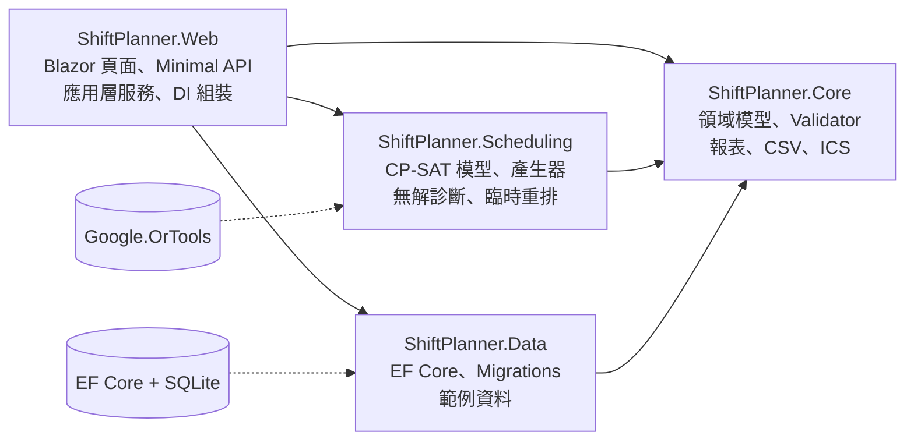
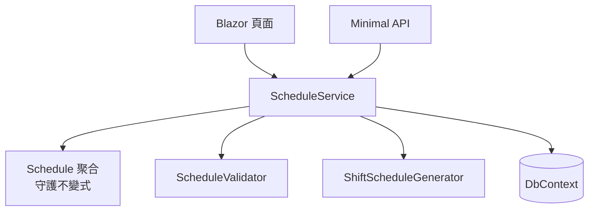
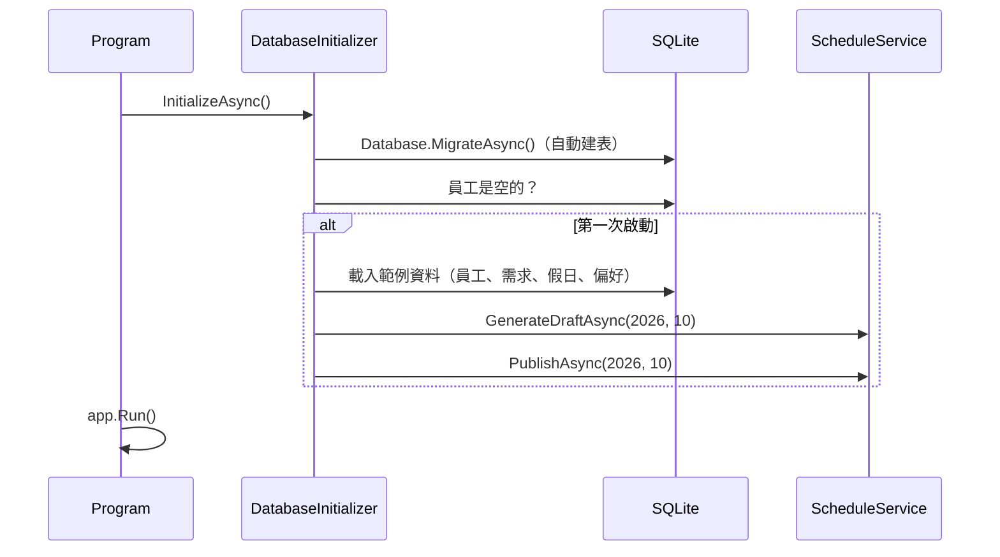

# 第 3 章　系統架構：分層、依賴方向與設計決策

> 本章目標：理解本專案如何切分成 4 個專案、為什麼依賴方向這樣安排，以及每一個關鍵設計決策背後的取捨。

---

## 3.1 專案切分與依賴方向



**規則：箭頭只能指向內層。** `Core` 在最內層，不知道任何其他專案存在。

| 專案 | 負責 | 不負責 |
|---|---|---|
| Core | 業務規則、驗證、報表計算、檔案格式 | 怎麼存、怎麼求解、怎麼顯示 |
| Scheduling | 把排班問題交給 CP-SAT 求解 | 資料從哪裡來 |
| Data | 怎麼存進 SQLite、範例資料 | 業務規則 |
| Web | 把以上組裝起來、處理 HTTP 與畫面 | 業務規則本身 |

### 為什麼 Validator 和產生器要放在不同專案？

題目要求：「驗證邏輯必須是一個獨立的 validator，可以對任意班表執行，與產生器分開實作。」

把 Validator 放在 `Core`、產生器放在 `Scheduling`，**專案參考**就保證了：Validator 不可能呼叫產生器的任何程式碼。兩者是對同一組規則的**兩套獨立實作**：

- Validator：「給我一份班表，我告訴你哪裡違規」（檢查）
- 產生器：「給我限制條件，我造出一份不違規的班表」（建構）

產生器每次產生完，**一定**會把結果交給 Validator 再檢查一次：

```csharp
// src/ShiftPlanner.Scheduling/ShiftScheduleGenerator.cs
/// <summary>產生器與 validator 是兩套獨立實作；結果不一致代表程式有錯，直接拋出。</summary>
private void EnsureValid(GenerationRequest request, IReadOnlyList<Assignment> assignments)
{
    var snapshot = new ScheduleSnapshot(
        request.Horizon, request.Employees, assignments, request.Calendar,
        request.Context, request.Leaves, request.Catalog, request.Following);
    var result = _validator.Validate(snapshot);
    if (!result.CanPublish)
    {
        throw new InvalidOperationException("產生器的結果未通過 validator 檢查（程式錯誤）：" + ...);
    }
}
```

> **教學重點**：這等於在產品程式碼中內建一層**交叉驗證**（N-version programming 的簡化版）。如果產生器的模型漏寫了一條限制，Validator 會立刻抓到，而不是讓錯誤的班表被發布。

---

## 3.2 應用層：把用例寫成服務

Web 專案裡的 `Application/` 資料夾是**應用層**，每個服務對應一組用例：

| 服務 | 用例 |
|---|---|
| `PlanningDataLoader` | 載入某月排班所需的全部資料（員工、需求、請假、偏好、前後月份） |
| `ScheduleService` | 取得狀態並即時驗證、產生草稿、加班／刪班／換班、發布 |
| `RescheduleService` | 產生重排提案、套用、捨棄 |
| `ReportService` | 月報、ICS 匯出 |

### 單一資料來源：`PlanningData`

產生器、Validator、報表都需要「某月的排班資料」。如果各自去資料庫查，很容易出現「產生器看到 A、Validator 看到 B」的不一致。本專案的做法是集中在一個地方：

```csharp
// src/ShiftPlanner.Web/Application/PlanningData.cs
public sealed record PlanningData(
    DateRange Period,
    IReadOnlyList<Employee> Employees,
    StaffingCalendar Calendar,
    IReadOnlyList<Leave> Leaves,
    IReadOnlyList<OffPreference> Preferences,
    IReadOnlyList<Assignment> PreviousMonth,
    ScheduleStatus? PreviousMonthStatus = null,
    FollowingContext? NextMonth = null)
{
    public ScheduleSnapshot Snapshot(IReadOnlyList<Assignment> assignments) => ...;   // 給 Validator
    public GenerationRequest GenerationRequest() => ...;                             // 給產生器
}
```

同一份 `PlanningData` 產生 Validator 的輸入和產生器的輸入，兩邊的資料**在結構上就不可能不一致**。

---

## 3.3 兩條入口，一套邏輯

系統有兩個入口：Blazor 頁面（給主管用）和 Minimal API（給整合測試和外部系統用）。兩者都呼叫**同一個** `ScheduleService`：



API 層只做 HTTP 的翻譯工作：把領域例外轉成對應的狀態碼。

```csharp
// src/ShiftPlanner.Web/Api/ScheduleEndpoints.cs（節錄）
catch (ScheduleLockedException ex)      → 409 Conflict
catch (SchedulePublishException ex)     → 422 Unprocessable Entity（附違規與缺口清單）
catch (ArgumentException / InvalidOperationException) → 400 Bad Request
```

> **教學重點**：例外的**型別**本身就帶有語意。`ScheduleLockedException` 代表「狀態不允許」，對應 409；`SchedulePublishException` 代表「內容不合格」，對應 422。用不同型別區分，比在訊息字串裡找關鍵字可靠得多。

---

## 3.4 Blazor Server 的一個陷阱：DbContext 的生命週期

Blazor Server 的每個使用者連線（circuit）可能存活好幾個小時。ASP.NET Core 的 `Scoped` 服務在 Blazor Server 中是「每個 circuit 一份」，所以 DbContext 會被**整個 circuit 共用**。

問題情境：

1. 主管按「換班」，服務先 `Remove` 一班，接著 `Add` 時拋出例外。
2. 例外被畫面接住，顯示錯誤訊息。
3. 但 DbContext 裡那筆 `Remove` 仍然在追蹤中。
4. 主管下一次做任何會存檔的操作時，那筆半套的刪除**被一起寫進資料庫**。

解法是：每個畫面操作都在**新的 DI scope** 中執行，操作結束 scope 就丟掉：

```csharp
// src/ShiftPlanner.Web/Infrastructure/ScopedRunner.cs
public async Task RunAsync<TService>(Func<TService, Task> action) where TService : notnull
{
    await using var scope = scopes.CreateAsyncScope();
    await action(scope.ServiceProvider.GetRequiredService<TService>());
}

// 頁面中的使用方式
await Runner.RunAsync<ScheduleService>(s => s.AddAsync(Year, Month, assignment));
```

> **教學重點**：框架的「預設生命週期」是為一般情境設計的。在 Web API 中，scoped 等於「每個 HTTP 請求」，很安全；換到 Blazor Server，同樣的設定意義就完全不同。

---

## 3.5 時間的注入：`TimeProvider`

題目要求「時間相關邏輯一律透過 `TimeProvider` 注入」。本專案中用到時間的地方：

| 用途 | 位置 |
|---|---|
| 發布時間 | `ScheduleService.PublishAsync` → `time.GetUtcNow()` |
| 「今天」（不能重排過去的日期、預設規劃月份） | `TaipeiTime.Today(time)` |
| ICS 的 `DTSTAMP` | `ReportService` |
| 求解耗時 | `ShiftScheduleGenerator` → `time.GetTimestamp()` |

註冊與替換：

```csharp
// 正式環境：Program.cs
builder.Services.AddSingleton(TimeProvider.System);

// 整合測試：用假時鐘取代
services.RemoveAll<TimeProvider>();
services.AddSingleton<TimeProvider>(Time);   // FakeTimeProvider，可隨意設定時間
```

測試可以把時間設成「台北時間 11/17 早上 9 點」，驗證「不能重排 11/16 的請假」（`RescheduleApiTests.不能重排已經過去的日期_以TimeProvider判斷今天`）。

> **常見錯誤**：`ShiftScheduleGenerator` 一開始用 `Stopwatch` 計時，違反了這條要求，是在驗收測試的靜態檢查中才被抓到的（測試報告的 D-1）。修正時刻意**不提供**「預設使用系統時鐘」的建構子，避免留下繞過注入的後門。

---

## 3.6 啟動流程



注意：範例的 10 月班表是**用正式的服務流程**產生並發布的，不是直接塞資料進資料庫。好處是範例資料一定符合所有規則；如果規則改了導致範例資料不合法，啟動時就會立刻失敗。

---

## 3.7 架構決策紀錄（ADR 風格）

| 決策 | 考慮過的選項 | 選擇 | 取捨 |
|---|---|---|---|
| UI 框架 | Razor Pages、Blazor Server | Blazor Server | ✅ 即時驗證不需寫 JavaScript　❌ 需處理 circuit 與 DbContext 生命週期 |
| 求解器 | CP-SAT、自寫區域搜尋 | CP-SAT | ✅ 能證明無解、重排共用模型　❌ 原生套件約 100 MB、結果非決定性 |
| EF 對應 | 另寫資料表類別、直接對應領域型別 | 直接對應 | ✅ 少一層轉換　❌ 領域型別要配合 EF 慣例 |
| ICS／CSV | 引入套件、自行實作 | 自行實作 | ✅ 不增加相依、完全掌握格式　❌ 要自己處理 RFC 細節（第 9 章） |
| 跨月上下文 | 只看前月、雙向、草稿也算 | 雙向，只用已發布月份，並強制依序發布 | ✅ 規則簡單可測試　❌ 不能跳著發布月份（第 8 章） |

---

## 本章小結

1. 依賴只能指向內層；專案參考本身就能強制架構規則（Validator 無法呼叫產生器）。
2. 產生器的結果再交給 Validator 檢查，等於內建交叉驗證。
3. 頁面與 API 共用同一套應用層服務，業務規則只有一份。
4. 注意框架預設值在不同情境下的意義（Blazor Server 的 scoped DbContext）。
5. 時間一律從外部注入，領域層只接收時間參數。

---

## 練習題

1. 如果有人把 Validator 搬到 `Scheduling` 專案，會失去什麼保證？
2. `ScheduleService.GetStateAsync` 每次都重新驗證整個月。16 人 × 30 天的規模下這沒問題，如果是 500 人呢？請提出一個增量驗證的設計，並說明它會讓哪些測試變難寫。
3. 為什麼 API 對「上個月仍是草稿時發布本月」回傳 400，而對「已發布的班表被修改」回傳 409？你會怎麼選？
4. ★ 新增一個 API：`GET /api/schedules/{y}/{m}/violations?employeeId=`，只回傳某位員工的違規。思考它應該放在哪一層、需要哪些測試。
5. ★ 把 `ScopedRunner` 拿掉、改成在頁面直接注入 `ScheduleService`，設計一個操作順序重現 3.4 節的問題，並寫成筆記。
