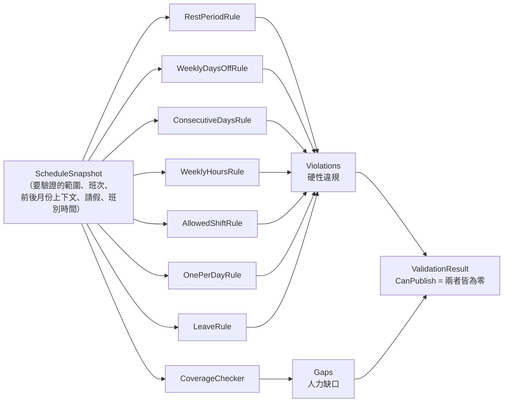

# 第 4 章　Validator：規則引擎與時間區間計算

> 本章目標：學會用**策略模式**實作一組可獨立測試的驗證規則，理解每條規則的演算法與邊界處理。程式碼位於 `src/ShiftPlanner.Core/Validation/`。

---

## 4.1 設計：輸入、規則、輸出



### 每條規則都是一個獨立的類別

```csharp
// src/ShiftPlanner.Core/Validation/IHardRule.cs
public interface IHardRule
{
    IEnumerable<Violation> Check(ScheduleSnapshot snapshot);
}
```

```csharp
// src/ShiftPlanner.Core/Validation/ScheduleValidator.cs
public static IReadOnlyList<IHardRule> DefaultRules() =>
[
    new RestPeriodRule(),
    new WeeklyDaysOffRule(),
    new ConsecutiveDaysRule(),
    new WeeklyHoursRule(),
    new AllowedShiftRule(),
    new OnePerDayRule(),
    new LeaveRule(),
];

public ValidationResult Validate(ScheduleSnapshot snapshot)
{
    var violations = rules
        .SelectMany(r => r.Check(snapshot))
        .OrderBy(v => v.Date)
        .ThenBy(v => v.EmployeeId)
        .ToList();
    return new ValidationResult(violations, _coverage.Check(snapshot).ToList());
}
```

這就是**策略模式**（Strategy Pattern）：Validator 不知道每條規則怎麼算，只負責收集結果。好處：

- **單一職責**：每條規則一個檔案，大約 30 到 50 行。
- **可獨立測試**：每條規則有自己的測試類別，測試失敗時一眼就知道是哪條規則。
- **開放封閉原則**：新增規則只要多寫一個類別，再加進 `DefaultRules()`。

### 違規要能「指到格子」

```csharp
public sealed record Violation(RuleCode Code, int EmployeeId, DateOnly Date, ShiftType? Shift, string Message);
```

`EmployeeId` + `Date`（+ `Shift`）讓 UI 能把違規標示在班表的某一格上。`Message` 是給人看的完整說明。

---

## 4.2 輸入：`ScheduleSnapshot`

```csharp
public ScheduleSnapshot(
    DateRange horizon,                        // 要驗證的範圍，例如 11/1–11/30
    IReadOnlyList<Employee> employees,
    IReadOnlyList<Assignment> assignments,    // 範圍內的班次
    IStaffingCalendar calendar,               // 每天每班需要幾人、什麼技能
    IReadOnlyList<Assignment>? context = null,       // 範圍之前（前月），唯讀
    IReadOnlyList<Leave>? leaves = null,
    ShiftCatalog? catalog = null,                    // 班別時間
    FollowingContext? following = null)              // 範圍之後（下月），唯讀
```

建構子會**快速失敗**（fail fast），任何不合理的輸入都立即拋出例外：

- 範圍內的班次日期不在 `horizon` 內
- 前月上下文的日期不早於 `horizon.Start`
- 後續上下文的日期不晚於 `horizon.End`
- 引用了不存在的員工

> **教學重點**：在建構時就檢查輸入，規則裡面就不用到處寫防禦性檢查。每條規則都可以**假設輸入是合法的**，程式更短也更好讀。

`AssignmentsOf(employeeId)` 回傳某人在「前月 + 本月 + 下月」的所有班次。規則用它就能自然地處理跨月，不需要特別寫跨月的程式碼。

---

## 4.3 H1 休息 11 小時：排序後檢查相鄰

### 演算法

```
對每位員工：
    取出他所有班次（含前後月份），換算成時間區間 [start, end)
    依 start 排序
    對每一對相鄰的 (prev, next)：
        若兩班都不在驗證範圍內 → 跳過（那是別的月份的事）
        rest = next.start − prev.end
        若 rest < 11 小時 → 違規，標示在「範圍內的那一班」
```

### 為什麼只檢查相鄰的兩班？

排序後，若 `prev` 和 `next` 相鄰，中間沒有別的班。不相鄰的兩班中間至少隔了一班，它們之間的距離一定**大於**任何一對相鄰班次之間的距離，所以只要相鄰的都合格，不相鄰的必然合格。這把 O(n²) 的比較降到 O(n log n)（排序）。

```csharp
// src/ShiftPlanner.Core/Validation/RestPeriodRule.cs（節錄）
var shifts = snapshot.AssignmentsOf(employee.Id)
    .Select(a => (Assignment: a, Interval: snapshot.Catalog.GetInterval(a)))
    .OrderBy(x => x.Interval.Start)
    .ToList();

for (var i = 1; i < shifts.Count; i++)
{
    var (prev, prevInterval) = shifts[i - 1];
    var (next, nextInterval) = shifts[i];
    var nextInHorizon = snapshot.Horizon.Contains(next.Date);
    if (!nextInHorizon && !snapshot.Horizon.Contains(prev.Date))
    {
        continue;
    }

    var rest = nextInterval.Start - prevInterval.End;
    if (rest >= minimumRest)
    {
        continue;
    }

    var marked = nextInHorizon ? next : prev;   // 標示在本月的那一班
    yield return new Violation(RuleCode.RestPeriod, employee.Id, marked.Date, marked.Shift, ...);
}
```

注意這條規則**完全沒有提到「早班」「晚班」「夜班」**。它只知道時間區間，所以班別時間改了也不用改程式。

---

## 4.4 H2 每週 2 天不排班：已知天數與未知天數

### 「不排班日」的定義

> 一天中**沒有任何班次開始**，就是不排班日。

這呼應第 1 章的「班次歸屬開始日」。週日 23:00 開始的夜班，週一早上 07:00 下班，週一仍是不排班日。

### 不完整的週

```
一週 = 週一 .. 週日（7 天）
已知到哪天 = 下個月已發布 ? 下個月底 : 本月底
未知天數 = max(0, 週日 − 已知到哪天)
需要休息天數 = max(0, 2 − 未知天數)
已知天數中的休息天數 = 已知天數 − 有班次開始的天數
違規 ⇔ 已知天數中的休息天數 < 需要休息天數
```

例：11/30（週一）那一週，若 12 月還沒發布，未知天數 = 6，需要休息天數 = max(0, 2 − 6) = 0，所以這週在 11 月不檢查，留給 12 月。

```csharp
// src/ShiftPlanner.Core/Validation/WeeklyDaysOffRule.cs（節錄）
foreach (var monday in horizon.WeekStarts())
{
    var sunday = monday.AddDays(6);
    var unknownDays = Math.Max(0, sunday.DayNumber - snapshot.KnownUntil.DayNumber);
    var required = Math.Max(0, RequiredDaysOff - unknownDays);
    var knownDays = 7 - unknownDays;
    var worked = Enumerable.Range(0, knownDays).Count(i => workDates.Contains(monday.AddDays(i)));
    var daysOff = knownDays - worked;
    if (daysOff >= required) continue;
    yield return new Violation(...);
}
```

> **進階思考**：「未知的天數可以用來補休息日」是一個**樂觀**的假設：它假設下個月一定排得出休息日。第 8 章會看到，這個假設讓產生器有機會把負擔推給下個月，後來在審查中被指出並修正。

---

## 4.5 H3 連續上班 ≤ 6 天：找出連續段

### 演算法

```
對每位員工：
    取出所有上班日期（含前後月份），去重、排序
    切成「連續段」(start, end)
    對每一段：
        若長度 ≤ 6 → 合格
        若整段都在範圍外 → 跳過
        否則違規，標示在「第 7 天」（若不在範圍內，就標在範圍內最接近的那天）
```

```csharp
// src/ShiftPlanner.Core/Validation/ConsecutiveDaysRule.cs（節錄）
private static IEnumerable<(DateOnly Start, DateOnly End)> Runs(IReadOnlyList<DateOnly> sortedDates)
{
    var start = sortedDates[0];
    for (var i = 1; i < sortedDates.Count; i++)
    {
        if (sortedDates[i] != sortedDates[i - 1].AddDays(1))   // 斷開了
        {
            yield return (start, sortedDates[i - 1]);
            start = sortedDates[i];
        }
    }

    yield return (start, sortedDates[^1]);
}
```

這是經典的「**連續區間分組**」技巧，時間複雜度 O(n)。用 `yield return` 寫成迭代器，呼叫端可以直接用 `foreach`。

### 為什麼要接上前後月份？

10/27–10/31 上 5 天、11/1–11/2 上 2 天。單看 11 月只有 2 天，單看 10 月只有 5 天，**合起來是 7 天**。只有把前月上下文一起算，才看得出來。

---

## 4.6 H4、H5、H6、H7：較簡單的規則

| 規則 | 演算法 | 複雜度 |
|---|---|---|
| H4 每週工時 | 依週分組（`ToLookup(a => a.Date.WeekStart())`），加總每班時數 | O(n) |
| H5 可上班別 | 逐一檢查 `employee.CanWork(shift)` | O(n) |
| H6 每天一班 | 依 (員工, 日期) 分組，數量 > 1 的每一筆都標示 | O(n) |
| H7 請假日 | 每個班次檢查是否落在該員工的請假區間 | O(n × 每人請假數) |

H6 的實作值得一看，它用 LINQ 查詢語法把「分組 → 過濾 → 展開」寫得很像規格本身：

```csharp
// src/ShiftPlanner.Core/Validation/OnePerDayRule.cs
from a in snapshot.Assignments
group a by (a.EmployeeId, a.Date) into day
where day.Count() > 1
let employee = snapshot.GetEmployee(day.Key.EmployeeId)
from a in day                       // 同一天的每一班都要標示，UI 上兩格都會變紅
select new Violation(RuleCode.OnePerDay, employee.Id, a.Date, a.Shift, ...);
```

---

## 4.7 人力缺口：`CoverageChecker`

人力缺口和硬性違規分開回報，因為它們的「主詞」不同：違規是「某人」的問題，缺口是「某一格」的問題。

```csharp
public sealed record CoverageGap(DateOnly Date, ShiftType Shift, Skills? Skill, int Required, int Actual, string Message);
```

`Skill` 為 `null` 代表總人數不足，否則代表某種技能人數不足。例如：

```
11/10 夜班 需要 1 位會英文的人員，目前只有 0 位
```

`CanPublish` 要求兩種都為零：

```csharp
public bool CanPublish => Violations.Count == 0 && Gaps.Count == 0;
```

---

## 4.8 設計檢討：Validator 的效能

每次主管點一下格子，系統就重新驗證整個月。16 人 × 30 天約 300 個班次，所有規則加起來是毫秒等級，完全不是問題。

如果規模變成 500 人，可以考慮**增量驗證**：只重新檢查被修改的員工。這是可行的，因為 H1 到 H7 都是「單一員工」的規則，只有人力缺口是「跨員工」的。

> **教學重點**：**先寫正確、簡單的版本，量測之後再最佳化。** 本專案的規模下，增量驗證只會增加複雜度與出錯機會。

---

## 本章小結

1. 策略模式讓每條規則可以獨立實作、獨立測試、獨立擴充。
2. 輸入物件在建構時快速失敗，規則本身就能假設輸入合法。
3. 休息規則「排序後只檢查相鄰」，並以時間區間計算，不列舉班別組合。
4. 不完整的週用「已知天數／未知天數」處理；連續上班用「連續區間分組」。
5. 違規與缺口分開回報，各自帶有能定位到畫面格子的資訊。

---

## 練習題

1. 證明：已依開始時間排序的時間區間序列中，若所有相鄰區間的間隔都 ≥ 11 小時，則任兩個區間的間隔都 ≥ 11 小時。（提示：區間長度為正。）
2. `WeeklyDaysOffRule` 對「範圍開始之前、但沒有提供前月上下文」的日子，會當作休息日。這是樂觀還是悲觀的假設？在什麼情況下會漏報違規？
3. 為什麼 `ConsecutiveDaysRule` 在連續段超出範圍時，要把違規標示在「範圍內最接近的那天」，而不是直接略過？
4. ★ 新增一條規則：「每月夜班不超過 8 班」。寫出 `MonthlyNightLimitRule`、加進 `DefaultRules()`，並補上「違反」與「剛好不違反」的測試。產生器需要同步修改嗎？如果不改會發生什麼事？（提示：3.1 節的交叉驗證。）
5. ★ 勞基法的實際規定是「每 7 日中至少應有 2 日之休息」，也就是任意連續 7 天，而不是固定週一到週日。請改寫 `WeeklyDaysOffRule` 為滑動視窗版本，並思考它和 H3 的關係。
