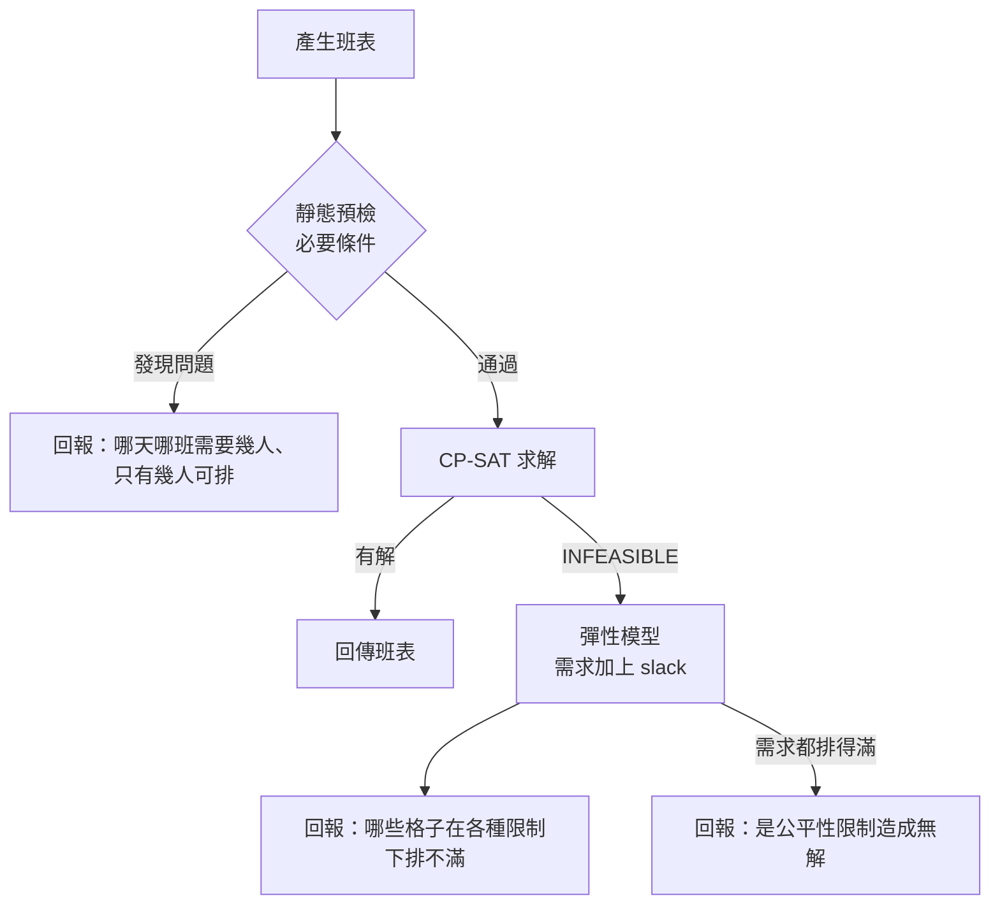

# 第 6 章　核心演算法二：可解釋的無解診斷

> 本章目標：理解「求解器只會說無解」的問題，學會用**必要條件預檢**與**彈性模型（slack 變數）**兩層方法，產生使用者看得懂的原因。程式碼位於 `src/ShiftPlanner.Scheduling/FeasibilityPrecheck.cs`、`InfeasibilityDiagnoser.cs`。

---

## 6.1 問題：「無解」不是一個答案

題目要求：

> 找不到可行解時，回報具體原因，例如「11/14 夜班需要 3 人，但可上夜班且不違反休息規定的只有 2 人」，**不可只回答「無解」**。

CP-SAT 回傳 `INFEASIBLE` 時，只代表「所有限制無法同時成立」，不會告訴你是哪幾條互相衝突。對主管來說，這等於沒有回答：他不知道該加人、改需求，還是調整請假。

本專案用兩層方法產生原因：



---

## 6.2 第一層：必要條件預檢

### 什麼是必要條件？

「有可行解」⇒「每個條件都成立」。如果能找到一個簡單、容易檢查的條件不成立，就**證明了無解**，而且這個條件本身就是很好的說明。

但反過來不成立：所有必要條件都通過，仍然可能無解（例如規則之間的連鎖效應），這時才需要第二層。

本專案的預檢包含三種必要條件：

### (1) 逐格的候選人數

對每一格（日期, 班別），計算「可能被排進來的人」：

```
候選人 = 可上該班別
       ∧ 當天沒請假
       ∧ 不會和前後月份已確定的班違反休息規定
```

```csharp
// src/ShiftPlanner.Scheduling/FeasibilityPrecheck.cs（節錄）
var candidates = request.Employees
    .Where(e => e.CanWork(shift)
        && !leaves[e.Id].Any(l => l.Contains(date))
        && !BlockedByContext(e.Id, date, shift))
    .ToList();

if (candidates.Count < required)
{
    yield return new InfeasibilityReason(date, shift, required, candidates.Count,
        $"{slot}需要 {required} 人，但{who}只有 {candidates.Count} 人");
}
```

產生的訊息正好符合題目要求的格式：

> 11/14 夜班需要 20 人，但可上夜班、未請假且不違反休息規定的只有 13 人

技能也用同樣方式檢查（「需要 1 位會英文的人員，但……只有 0 位」）。

### (2) 每日總人數

每人每天最多一班，所以一天的總需求人數不能超過當天能上班的人數。這個檢查特別能抓到**跨月造成的問題**：前月月底已經上了 5 天的人，11/1 必須休假（第 8 章）。

> 11/1 共需要 8 人上班，但只有 6 人可排，其中 10 人因上個月月底的排班當天必須休假（每週休息日、連續上班或週工時限制）

### (3) 每週總產能

對完整落在本月的每一週：

```
需求 = Σ 每天每班的需求人數
產能 = Σ 每人 min(5 天, 未請假天數, 工時上限 ÷ 8)
需求 > 產能 ⇒ 無解
```

### 為什麼預檢要放在求解之前？

1. **說明品質高**：預檢的原因是「直接可理解」的事實。
2. **快**：不需要求解器，毫秒等級。
3. **精確**：每一條都是真正的必要條件，不會誤報。

> **教學重點**：設計預檢時，每一條都要能證明「這條不成立 ⇒ 一定無解」。如果加了一條「通常會無解」的啟發式檢查，就可能把有解的情況擋掉，那比不說明更糟。

---

## 6.3 第二層：彈性模型（Elastic Model）

預檢通過但 CP-SAT 仍然無解，代表是**多條規則的交互作用**造成的。例如：

> 11/10 夜班要 7 人，11/11 早晚班合計要 10 人。上了 11/10 夜班的 7 人，11/11 只能上夜班或休息（休息規則）。所以 11/11 早晚班只剩 9 人可用，少 1 人。
>
> 單看任何一格，候選人數都夠，預檢抓不到。

### 想法：把「必須滿足」改成「盡量滿足」

把每條需求限制加上一個 **slack 變數**（缺額）：

$$\sum_e x_{e,d,s} + \text{slack}_{d,s} \ge 需求(d,s), \qquad 0 \le \text{slack}_{d,s} \le 需求(d,s)$$

然後**目標函數只剩**：

$$\min \sum \text{slack}_{d,s}$$

這個模型**一定有解**：大不了全部 slack 都等於需求，一個人都不排。求解器會找出「在所有硬性規則下，最少要缺多少人」，而 slack > 0 的格子就是排不滿的地方。

```csharp
// src/ShiftPlanner.Scheduling/ScheduleModel.cs
private void AddAtLeast(LinearExpr staffed, int required, DateOnly date, ShiftType shift, Skills? skill)
{
    if (!_elastic || required == 0)
    {
        Model.AddLinearConstraint(staffed, required, long.MaxValue);   // 一般模式：硬限制
        return;
    }

    var slack = Model.NewIntVar(0, required, $"slack_{date:MMdd}_{shift}_{skill}");
    Model.AddLinearConstraint(staffed + slack, required, long.MaxValue);
    _objective.Add(slack);                                           // 診斷模式：最小化缺額
    _slacks.Add(new DemandSlack(date, shift, skill, required, slack));
}
```

注意：**同一個 `ScheduleModel` 類別**用 `elastic` 參數切換兩種模式。診斷模式下：

- 人數與技能需求變成彈性的（加 slack）
- 夜班差距限制拿掉（它也可能是無解的原因）
- 偏好、公平性等軟性目標拿掉（只關心缺額）
- 所有硬性規則（休息、每週、連續、工時）**保持不變**

### 解讀結果

```csharp
// src/ShiftPlanner.Scheduling/InfeasibilityDiagnoser.cs（節錄）
var reasons = model.Slacks
    .Select(s => (Slack: s, Shortfall: (int)solver.Value(s.Shortfall)))
    .Where(x => x.Shortfall > 0)
    .Select(x => ToReason(x.Slack, x.Slack.Required - x.Shortfall))
    .ToList();

if (reasons.Count == 0)
{
    // 需求都排得滿，那原模型無解的原因只剩「夜班差距 ≤ 2」這條
    reasons.Add(... $"人力需求都排得滿，但無法同時讓全職員工的夜班數差距 ≤ {request.MaxNightSpread}");
}
```

訊息格式：

> 11/11 早班需要 5 人，在休息、連續上班與工時限制下最多只能排 4 人

### 第三種結果：彈性模型也無解

彈性模型拿掉了所有需求，理論上一定有解。如果它還是無解，代表**上下文本身就有矛盾**，例如前月已發布的班表已經讓某人在跨月的週超時了。這時回報：

> 即使不考慮人力需求，仍無法同時滿足休息、連續上班與工時限制；請檢查前月班表與請假設定

---

## 6.4 這個方法的限制

彈性模型給的是「**一種**最少缺額的排法」中缺額的位置，不是唯一答案。

例：11/11 早班和晚班都缺 1 人，但總共只缺 1 人。求解器可能把缺額放在早班，也可能放在晚班。所以：

- ✅ 「總缺額」是確定的（最佳目標值）
- ⚠️ 「缺在哪一格」可能因求解而不同

對使用者來說，這通常已經足夠：他知道「那幾天附近的人力不夠」，可以去調整需求或請假。

### 和學術上的方法比較

| 方法 | 說明 | 本專案 |
|---|---|---|
| IIS（不可約不可行子集） | 找出最小的一組互相衝突的限制 | 未採用：對主管來說，「第 437 條限制和第 1029 條衝突」不是好的說明 |
| Unsat core / assumptions | CP-SAT 支援以假設文字找出衝突核心 | 未採用：同上，需要再翻譯成業務語言 |
| **彈性模型（goal programming）** | 放寬限制，最小化違反量 | ✅ 採用：結果直接對應到「哪一格缺幾人」，最貼近使用者的語言 |

> **教學重點**：「可解釋」要用**使用者的語言**來解釋。技術上最精確的方法（IIS），不一定是最好理解的。

---

## 6.5 測試設計

每一種原因都有對應的測試（`tests/ShiftPlanner.Scheduling.Tests/InfeasibilityDiagnosisTests.cs`）：

| 測試 | 觸發的機制 |
|---|---|
| `夜班需求超過可排人數_原因包含日期班別需要人數與可用人數` | 預檢（1） |
| `會英文的人當天都請假_回報技能不足` | 預檢（1）技能 |
| `前月最後一天上夜班的人_不會被算進本月第一天早班的可用人數` | 預檢（1）上下文 |
| `整週需求超過全體可上班數_回報該週產能不足` | 預檢（3） |
| `單格都排得到但受休息規定連鎖影響_由診斷模型指出排不滿的格子` | 彈性模型 |
| `前月月底多數人只休1天_診斷指出11月1日因此必須休假的人數` | 預檢（2） |

連鎖效應的測試**故意**設計成「單格都夠、合起來不夠」，並斷言訊息含有「最多只能排」，確認走的是彈性模型這條路，而不是預檢。

---

## 本章小結

1. 求解器的「無解」對使用者沒有意義，要轉譯成業務語言。
2. 第一層：必要條件預檢，快速、精確、說明清楚；每條都要能證明「不成立 ⇒ 無解」。
3. 第二層：彈性模型，把需求改成 slack 並最小化缺額，找出規則交互作用造成的缺口。
4. 同一個模型類別用旗標切換一般模式與診斷模式，硬性規則只寫一次。
5. 選擇解釋方法時，以「使用者能不能據此行動」為準。

---

## 練習題

1. 舉一個「所有預檢都通過，但實際無解」的例子（不能和 6.3 節的相同）。
2. 每週產能檢查用 `min(5, 未請假天數, 工時上限 ÷ 8)`。為什麼不需要考慮休息規則（H1）？這個上界在什麼情況下會太樂觀？
3. 彈性模型中，為什麼要把「夜班差距 ≤ 2」拿掉，而不是也加上 slack？
4. ★ 為彈性模型的 slack 加上權重：技能缺口的權重比人數缺口高，讓求解器優先把缺額放在「只缺人數」的格子。這會讓診斷結果更好還是更差？用一個例子說明。
5. ★ 新增預檢：「每位員工在本月的可上班天數」總和 vs. 整月總需求，並寫出測試。它和每週產能檢查相比，哪個能抓到更多問題？
