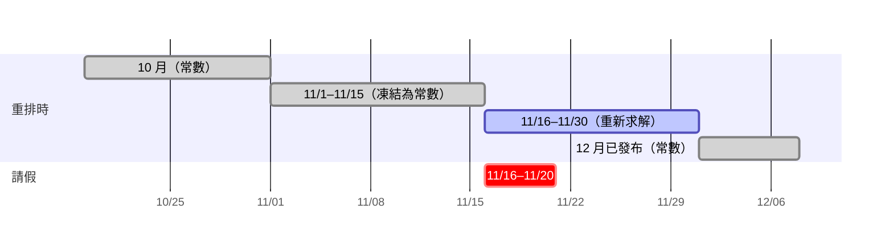
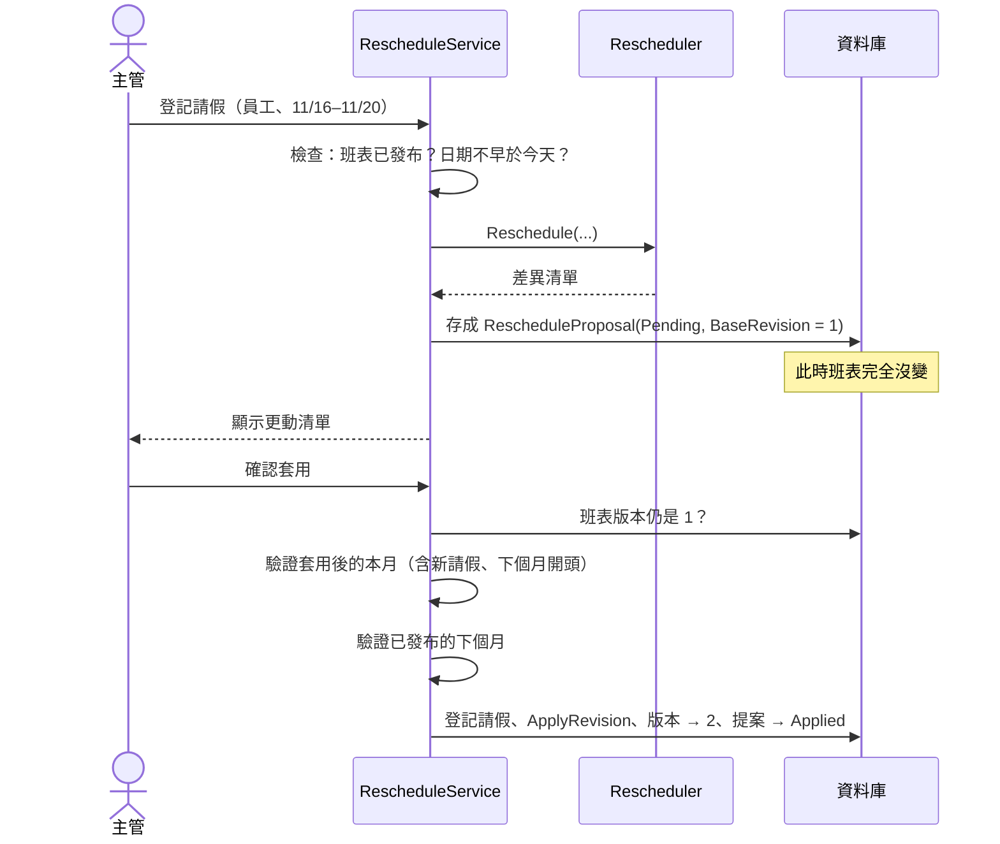

# 第 7 章　核心演算法三：最小變動的臨時重排

> 本章目標：學會用**凍結**與**基準差異**兩個技巧，把「重排」轉成同一個最佳化模型的變形；並理解「提案 → 確認」的流程與並行控制。程式碼位於 `src/ShiftPlanner.Scheduling/Rescheduler.cs`、`src/ShiftPlanner.Web/Application/RescheduleService.cs`。

---

## 7.1 問題

> 已發布的 11 月班表中，某位員工 11/16 起臨時請假 5 天。系統要：
> 1. 只重排受影響日期之後的班；
> 2. 盡量少更動其他人已排好的班；
> 3. 列出所有被更動的班次，主管確認後才套用；
> 4. 結果仍然零違規。

最直覺的做法是「把這個人的班刪掉，再找人補」。但補人可能造成連鎖反應：補上來的人如果因此違反休息規定，又要再把他原本的某一班換掉……手寫這種連鎖修補非常容易出錯。

本專案的做法：**不寫任何修補邏輯**，而是重新使用第 5 章的模型，只改變輸入。

---

## 7.2 技巧一：凍結（把過去變成常數）

```csharp
// src/ShiftPlanner.Scheduling/Rescheduler.cs
var frozen   = request.Published.Where(a => a.Date < request.FromDate).ToList();   // 11/16 之前
var original = request.Published.Where(a => a.Date >= request.FromDate).ToList();  // 11/16 之後

var result = generator.Generate(new GenerationRequest
{
    Horizon   = new DateRange(request.FromDate, request.Month.End),   // 只重解 11/16～11/30
    Context   = [.. request.PreviousMonth, .. frozen],                // 10 月 + 11/1～11/15 都是常數
    Following = request.NextMonth,                                     // 已發布的 12 月也是常數
    Leaves    = request.Leaves,                                        // 包含這次的新請假
    Baseline  = original,                                              // 原本的 11/16～11/30
    FairnessPeriod = request.Month,                                    // 公平性仍然以整月計算
    MaxNightSpread = null,                                             // 夜班差距只當軟性目標
    ...
});
```



**關鍵洞察**：11/1–11/15 的班次被當成**上下文**（就像前一個月一樣），所以：

- 它們**不是變數**，求解器在結構上**不可能**更動它們。
- 但它們仍然參與規則計算：11/15 夜班的人，11/16 不能上早班；11/9–11/15 這週已上 5 天的人……

驗收 #9 要求「需有測試證明 11/16 之前的班次完全沒變」。在這個設計下，「沒變」是**結構上的保證**，不是「剛好沒動到」。

> **教學重點**：這是第 5 章 `ShiftOn` 統一處理「變數與常數」帶來的回報。重排不需要寫任何新的限制式，只要把凍結的部分放進 `Context`。

---

## 7.3 技巧二：基準差異（盡量少改）

「盡量少改」的意思是：**和原班表不同的格子越少越好**。這是兩個 0/1 向量之間的漢明距離（Hamming distance）：

$$\text{變動數} = \sum_{e,d,s} |x_{e,d,s} - b_{e,d,s}|$$

其中 $b$ 是原班表（常數 0 或 1）。絕對值不是線性的，但因為 $b$ 是**已知常數**，可以分成兩種情況：

| 原本 $b$ | 現在 $x$ | $\|x - b\|$ | 線性寫法 |
|---|---|---|---|
| 1（原本有排） | 0 或 1 | $1 - x$ | 常數 1，減去 $x$ |
| 0（原本沒排） | 0 或 1 | $x$ | 就是 $x$ |

```csharp
// src/ShiftPlanner.Scheduling/ScheduleModel.cs
private void AddBaselineDeviation()
{
    var baseline = _request.Baseline.Select(a => (a.EmployeeId, a.Date, a.Shift)).ToHashSet();
    foreach (var (key, x) in _x)
    {
        var wasAssigned = baseline.Contains(key);
        Model.AddHint(x, wasAssigned);                       // 以原班表作為搜尋起點
        if (wasAssigned)
        {
            _objective.Add(BaselineChangeWeight);            // 500 × (1 − x)
            _objective.AddTerm(x, -BaselineChangeWeight);
        }
        else
        {
            _objective.AddTerm(x, BaselineChangeWeight);     // 500 × x
        }
    }
}
```

> **建模技巧**：「和已知常數的絕對差」永遠可以線性化，不需要輔助變數。這在任何「修改既有方案」的問題（重排、重新路由、增量部署……）都用得到。

### `AddHint`：給求解器一個好的起點

`AddHint(x, wasAssigned)` 告訴 CP-SAT「原班表是一個很接近答案的解」。求解器會從那附近開始搜尋，通常很快就找到「只改幾格」的解。Hint 不是限制，不保證採用。

### 權重的取捨

| 項目 | 權重 |
|---|---:|
| 強烈休假偏好 | 1000 |
| **與原班表不同的格子** | **500** |
| 一般休假偏好 | 100 |
| 公平性 | 20～50 |

變動成本 500 低於強烈偏好 1000：系統不會為了少改一格而違反別人的強烈休假偏好。高於一般偏好與公平性：系統寧可讓夜班稍微不平均，也不要多動別人。

**請假者被移除的班不算成本**。請假日的變數根本不存在（第 5 章），那些班「一定會被移除」，不是求解器的選擇。

---

## 7.4 為什麼重排時夜班差距只是軟性目標

產生時，「全職夜班差距 ≤ 2」是硬限制。重排時改成只放在目標函數裡。原因是：

請假者被移除了 4 個夜班，他的夜班數一定會下降。如果仍然堅持差距 ≤ 2，求解器就必須**把其他人的夜班也拿掉**來重新平衡，牽動更多人，違反「盡量少改」的目標。

這是一個明確的取捨，README 的「已知限制」中有說明：重排後夜班差距可能超過 2。

---

## 7.5 計算差異清單

求解完成後，用值物件的集合運算算出差異（第 2 章）：

```csharp
var removed = original.Except(result.Assignments).ToList();   // 原本有、現在沒有
var added   = result.Assignments.Except(original).ToList();   // 原本沒有、現在有
```

某次實際執行的結果（李美玲 11/16–11/20 請假，她原本有 4 班；CP-SAT 每次的解可能不同，見第 5 章）：

| 日期 | 班別 | 移除 | 新增 |
|---|---|---|---|
| 11/16（一） | 早班 | 李美玲 | 劉雅婷 |
| 11/17（二） | 早班 | 李美玲 | 謝依婷 |
| 11/18（三） | 夜班 | 李美玲 | 王小明 |
| 11/19（四） | 早班 | 劉雅婷 | 林建宏 |

注意最後一列：劉雅婷 11/16 去補了早班，她原本 11/19 的早班就被換給林建宏。這就是**連鎖反應**，而它是求解器自動處理的，不需要手寫任何修補邏輯。

---

## 7.6 流程：提案 → 確認 → 套用



### 為什麼要「提案」而不是直接套用？

1. **題目要求**：主管確認後才套用。
2. **可以反悔**：主管看了清單覺得不好，可以捨棄，班表完全沒動過。
3. **可稽核**：提案保存了「誰請假、改了哪些格子、根據哪一版」。

### 樂觀並行控制：`BaseRevision`

提案記下「根據第幾版產生」。套用時如果班表已經不是那一版（例如另一個提案先套用了），就拒絕：

```csharp
// src/ShiftPlanner.Web/Application/RescheduleService.cs
if (schedule.Revision != proposal.BaseRevision)
{
    throw new InvalidOperationException(
        $"提案產生後班表已更新為第 {schedule.Revision} 版（提案根據第 {proposal.BaseRevision} 版），請重新產生提案");
}
```

這是經典的**樂觀並行控制**（optimistic concurrency control）：不鎖定資料，而是在寫入時檢查版本有沒有變。題目說只有一位主管，但他可能同時開兩個分頁，這個檢查仍然有意義。

### 套用前再驗證一次

即使提案是由產生器算出來的（產生器自己也會驗證），套用時仍然重新驗證：

- 本月（加上新的請假、下個月開頭）
- 已發布的下個月（以重排後的本月作為上下文）

> **教學重點**：**在寫入點驗證**，不要信任「之前算過了」。提案可能是舊的、資料可能被改過，甚至提案本身可能是手動製造的。整合測試 `套用會讓已發布的下個月違規的提案_被拒絕且兩個月都不變` 就是直接在資料庫建立一份壞提案來驗證這一點。

---

## 7.7 其他防呆

| 檢查 | 原因 |
|---|---|
| 只有已發布的班表能臨時重排 | 草稿直接修改就好 |
| 請假開始日不能早於今天（台北時間，`TimeProvider`） | 不能更改已經過去的班 |
| 請假結束日不能早於開始日 | 輸入錯誤 |
| 捨棄或已套用的提案不能再套用 | 狀態機（`RescheduleProposal.EnsurePending`） |

---

## 本章小結

1. 重排 = 同一個模型 + 不同的輸入：凍結的部分放進上下文，就在結構上保證不會被改。
2. 「和已知常數的絕對差」可以直接線性化；`AddHint` 給求解器好的起點。
3. 權重設計決定了取捨：變動成本介於強烈偏好與一般偏好之間。
4. 連鎖修補交給求解器，不手寫修補邏輯。
5. 提案 → 確認讓使用者有反悔的機會；`BaseRevision` 實現樂觀並行控制；寫入點一定再驗證。

---

## 練習題

1. 如果不凍結 11/16 之前的班，只在目標函數中給它們很高的變動成本（例如 10000），會有什麼差別？哪個方法的保證比較強？
2. 為什麼變動成本 500 要低於強烈偏好 1000？構造一個情境，說明反過來設定會讓結果變差。
3. 7.5 節的例子中，劉雅婷補了 11/16 的早班，她原本 11/19 的早班又換給林建宏，共多了 2 格變動。請在本機重現一次重排，觀察你得到的結果，並推測求解器為什麼選擇這樣的連鎖（提示：從語言技能需求、每週休息日與工時著手）。
4. ★ 目前每個「不同的格子」成本相同。設計一個版本：「換班別」（同一人同一天從早班改晚班）的成本比「換人」低。需要修改哪些地方？
5. ★ 支援「多人同時請假」：一次登記兩位員工的請假，產生一份合併的提案。思考 `RescheduleRequest` 和 `RescheduleProposal` 要怎麼改。
