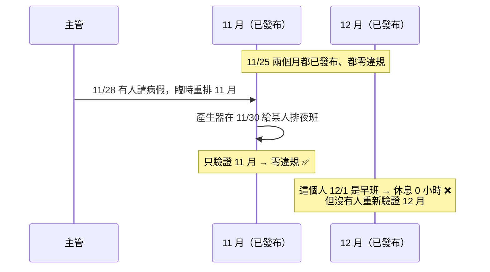

# 第 8 章　跨月問題：從程式碼審查學到的設計

> 本章目標：透過一個真實的設計缺陷（從實作、被審查指出，到修正），學會辨識「期間邊界」問題，理解雙向上下文、發布順序與「貪婪規則」的陷阱。

這一章和前面不同，它記錄的是**一個設計如何被發現不夠好、又如何修正**。這在實務上比「一次就做對」更常見，也更值得學習。

---

## 8.1 第一版的設計：只往前看

第一版就意識到跨月問題：2026/11/1 是週日，10/26–11/1 這一週橫跨兩個月。所以驗證 11 月時，帶入**前一個月已發布的班表**作為上下文。

```
驗證 11 月 = 10 月（唯讀上下文） + 11 月（驗證範圍）
```

這解決了「月初」的問題，所有測試也都通過。

---

## 8.2 審查發現的問題

完成後，一位審查者讀了程式碼，指出：

> 跨月檢查只往前看，修改前一個月時不會檢查下一個月。

並提出兩個情境：

### 情境 A：重排本月，破壞已發布的下個月



兩份班表都是「已發布」，違規卻沒有人發現。

### 情境 B：跳著發布

程式允許在 11 月還是草稿時，就發布 12 月。此時 12 月是在「沒有前月上下文」的情況下驗證的。之後 11 月定案發布時，也不會回頭檢查 12 月。

---

## 8.3 先重現，再修正

修正之前，第一件事是**寫一個會失敗的測試**，證明問題真的存在：

```csharp
// tests/ShiftPlanner.Scheduling.Tests/CrossMonthTests.cs（概念）
// 12 月已發布；11 月月底有班的人逐一請 11/28～11/30 的假並重排
// 斷言：12 月（以重排後的 11 月為上下文）必須零違規
```

修正前執行，測試失敗，訊息是：

```
員工 #2 請假後 12 月出現違規：
  吳家豪 11/30 夜班 → 12/1 早班 只休息 0 小時（需 ≥ 11 小時）；
  吳家豪 11/30–12/6 這週只有 1 天不排班（需 ≥ 2 天）；
  吳家豪 11/30–12/6 這週排了 48 小時（上限 40 小時）
```

一次請假，**同時**違反了休息、每週休息日、每週工時三條規則。這也說明了問題的嚴重性。

> **教學重點**：先讓測試以「正確的理由」失敗（red），再修正（green）。如果測試在修正前就通過，代表它沒有測到問題（第 10 章有一個真實的例子）。

---

## 8.4 修正一：雙向上下文

### 在 Validator 中加入「後續上下文」

```csharp
// src/ShiftPlanner.Core/Domain/FollowingContext.cs
/// 範圍之後已確定的班次（通常是已發布的下個月），唯讀。
/// KnownUntil 之前沒有班次的日子視為休假；之後則視為未知，可以用來補足休息日。
public sealed record FollowingContext(DateOnly KnownUntil, IReadOnlyList<Assignment> Assignments);
```

為什麼需要 `KnownUntil`？因為「沒有班」有兩種意思：

- 在**已知範圍內**沒有班 → 那天確定休假。
- 在**未知範圍**（還沒排）→ 不知道，可能休也可能上班。

只給一份班次清單無法區分這兩種情況，所以要明確告訴 Validator「班次確定到哪一天」。

### 各規則的修改量很小

因為第 4 章的規則都是透過 `AssignmentsOf(employeeId)` 取得「前月 + 本月 + 下月」的班次，大部分規則幾乎不用改：

| 規則 | 修改 |
|---|---|
| H1 休息 | 原本只檢查「後一班在範圍內」，改成「任一班在範圍內」 |
| H2 每週休息日 | 未知天數從「本月底之後」改成「`KnownUntil` 之後」 |
| H3 連續上班 | 過濾條件加上「整段都在範圍之後」也略過 |
| H4 每週工時 | **不用改**：跨月的週自動加總了下個月的班 |

> **教學重點**：第 4 章的設計（規則透過統一的介面取得班次，而不是自己去拼湊上下文）在這裡得到回報。好的抽象讓需求變更的影響範圍變小。

### 產生器與重排也要往後看

第 5 章的 `ShiftOn` 加上一個分支，下個月的日子回傳常數；休息規則多一個方向（本月最後幾天 → 下個月開頭）。重排時把已發布的下個月放進 `Following`。

---

## 8.5 修正二：發布順序

雙向上下文解決了情境 A，但情境 B（跳著發布）還在。有三種選擇：

| 選項 | 說明 | 缺點 |
|---|---|---|
| **強制依序發布** | 上個月已建立但還是草稿時，本月不能發布 | 不能跳著發布 |
| 不限順序，回頭驗證 | 發布某月時，若下個月已發布就一併驗證 | 規則與測試組合多 |
| 草稿也當上下文 | 前後月份不論草稿或已發布都帶入 | 本月能不能發布，會受到下個月一份**隨手產生的草稿**影響 |

本專案和需求方討論後選擇**強制依序發布，且只用已發布的月份當上下文**：

```csharp
// src/ShiftPlanner.Web/Application/ScheduleService.cs
if (data.PreviousMonthIsDraft)
{
    throw new InvalidOperationException(
        $"{prev.Year}/{prev.Month} 班表尚未發布；請先發布上個月，跨月的休息與連續上班限制才能檢查");
}
```

畫面上也會說明原因，並停用發布按鈕。

### 實測：這個限制擋下了什麼？

在 11 月還是草稿時產生了 12 月草稿。11 月發布後，再以 11 月為上下文檢查那份 12 月草稿：

```
violations 11
  林建宏 11/30 晚班 → 12/1 早班 只休息 8 小時（需 ≥ 11 小時）
  林建宏 11/30–12/6 這週只有 1 天不排班（需 ≥ 2 天）
  林建宏 11/30–12/6 這週排了 48 小時（上限 40 小時）
  ...
```

在修正之前，這份有 11 個跨月違規的 12 月草稿**可以直接發布**。現在它必須以定案的 11 月為上下文重新產生，才能發布。

---

## 8.6 第二個問題：貪婪的月底規則

審查還指出另一個比較隱微的問題。

回顧第 4 章：月底不完整的週，只要求 `max(0, 2 − 未知天數)` 天休息。10/26–10/31 這 6 天在 10 月，11/1 在 11 月，未知天數 = 1，所以 10 月只要求這 6 天中休 **1 天**。

推論：

```
10/26–10/31 只休 1 天的人 → 這週還差 1 天休息 → 11/1 必須休假
11/1 是週日，需要 3 + 3 + 2 = 8 人上班
如果 10 月底有超過 8 人只休 1 天 → 11/1 只剩不到 8 人 → 11 月第一天無解
```

而且，排 10 月時完全看不出問題，**要等到排 11 月時才爆發**。

### 這是一種「貪婪」

每個月都在「規則允許的範圍內」排出最好的結果，卻把負擔推給了下個月。這和經典的貪婪演算法陷阱一樣：**局部最佳，不保證整體可行**。

實際檢查範例資料：10 月有 2 到 3 人在 10/26–10/31 只休 1 天。範例資料沒有出事，只是因為目標函數「每排一班成本 1」讓產生器盡量少排班，運氣好而已。

### 修正：讓求解器「預留」

不改硬性規則（月底只要求 `max(0, 2 − 未知天數)` 仍然是正確的法規解讀），而是在**目標函數**加上成本：每把一天休假推給下個月，成本 30。

```csharp
// src/ShiftPlanner.Scheduling/ScheduleModel.cs（簡化寫法：實際程式用 LinearExprBuilder 組出 worked − deferred）
private void DiscourageDeferredRest(LinearExpr worked, int knownDays, string name)
{
    var deferred = Model.NewIntVar(0, 2, $"deferred_rest_{name}");
    // deferred ≥ 2 − (已知天數 − 上班天數)，也就是 上班天數 − deferred ≤ 已知天數 − 2
    Model.AddLinearConstraint(worked − deferred, long.MinValue, knownDays − 2);
    _objective.AddTerm(deferred, DeferredRestWeight);   // 30
}
```

這是第 6 章 slack 技巧的另一種用法：`deferred` 是「這週還差幾天休息、要留給下個月」的缺額，把它放進目標函數，求解器就會盡量讓它為 0。

權重 30 低於一般休假偏好（100），所以不會為了預留休息日而犧牲員工的偏好。

修正後重新產生 10 月：沒有人在 10/26–10/31 只休 1 天。

### 萬一還是無解，要能說明

第 6 章的「每日總人數」預檢，就是為這個情境加入的：

> 11/1 共需要 8 人上班，但只有 6 人可排，其中 10 人因上個月月底的排班當天必須休假（每週休息日、連續上班或週工時限制）

---

## 8.7 一般化：期間邊界問題

跨月問題是**期間邊界問題**的一個例子。只要系統把連續的時間切成一段一段處理，就會遇到：

| 領域 | 邊界問題 |
|---|---|
| 排班 | 跨月的週、連續上班、夜班跨日 |
| 會計 | 跨年度的應計費用、期末調整 |
| 計費 | 跨計費週期的用量、按比例計費 |
| 資料處理 | 批次邊界上的視窗聚合（例如「過去 7 天」） |

檢查清單：

1. 有哪些規則的「視窗」會跨越切分的邊界？
2. 處理某一段時，前面和後面的段落是已確定、草稿，還是未知？
3. 修改某一段時，誰負責重新檢查相鄰的段落？
4. 「未知」是被樂觀處理（假設之後能補救）還是悲觀處理？樂觀的話，會不會把負擔推給下一段？

---

## 本章小結

1. 跨期間的規則要**雙向**檢查；修改某一段，可能影響後面已確定的段落。
2. 「沒有資料」要區分「確定沒有」和「未知」，所以後續上下文需要 `KnownUntil`。
3. 處理順序本身可以是一條規則（強制依序發布），用來排除難以檢查的狀態組合。
4. 局部最佳的規則可能把成本推給下一段；用目標函數中的軟性成本「預留空間」。
5. 修正前先寫會失敗的測試；好的抽象讓修正的影響範圍變小。

---

## 練習題

1. 如果選擇「不限順序，回頭驗證」，發布 11 月時要驗證哪些月份？重排 11 月時呢？列出所有需要的測試組合。
2. 8.6 節的懲罰權重是 30。如果設成 2000（高於強烈偏好），會發生什麼事？
3. 夜班也跨越了「日」的邊界（23:00–隔天 07:00）。本專案怎麼處理它？這和跨月問題有什麼相似之處？
4. ★ 目前月底的休息日只在「不完整的週」預留。連續上班（H3）也有同樣的問題：10 月最後 6 天都上班的人，11/1 必須休假。為 H3 設計類似的軟性成本，並寫測試。
5. ★ 實作一個「月份總覽」頁面，顯示每個月的狀態（未建立／草稿／已發布）與跨月檢查是否已完成，讓主管一眼看出哪些月份需要處理。
