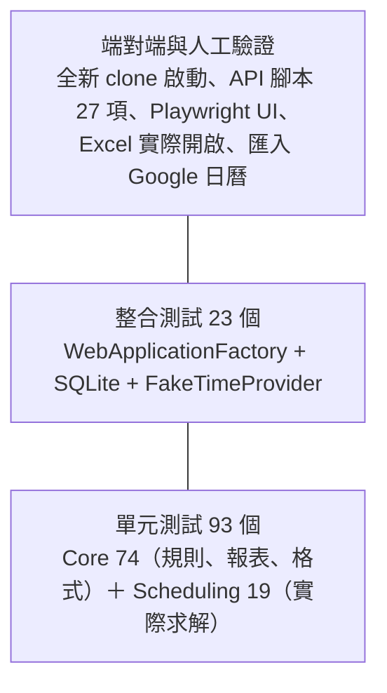

# 第 10 章　測試策略：從單元測試到不穩定測試的根因

> 本章目標：理解本專案的測試分層與每一層的目的，學會 TDD 的實際節奏、邊界值設計、整合測試的隔離技巧，並從兩次真實的不穩定測試（flaky test）中學到如何測試非決定性的演算法。

---

## 10.1 測試金字塔



| 層級 | 速度 | 抓什麼問題 | 本專案的例子 |
|---|---|---|---|
| 單元 | 毫秒 | 單一規則、單一函式的邏輯 | 「休息剛好 11 小時不違規」 |
| 整合 | 秒 | 元件之間的接線、資料庫、HTTP 狀態碼 | 「已發布的班表被修改時回傳 409」 |
| 端對端 | 分鐘 | 「真的能用」：部署、設定、外部軟體 | 「Excel 開啟 CSV 不會變成日期」 |

**越下層越多、越快、越穩定；越上層越少、越慢、越接近使用者。**

---

## 10.2 TDD 的實際節奏：Red → Green → Refactor

本專案的每個功能都先寫測試。以下是幾個真實的例子。

### 例一：先確認測試會失敗

修正「產生器用 `Stopwatch` 計時」（D-1）時，先寫測試：

```csharp
[Fact]
public void 求解耗時由注入的TimeProvider計算()
{
    var clock = new SteppingTimeProvider(TimeSpan.FromSeconds(1.5));   // 每次讀取前進 1.5 秒
    var result = new ShiftScheduleGenerator(clock).Generate(request);
    Assert.Equal(TimeSpan.FromSeconds(1.5), result.Elapsed);
}
```

執行，**編譯失敗**（`ShiftScheduleGenerator` 沒有接受 `TimeProvider` 的建構子）。這就是 red。接著修改產生器，測試通過，這是 green。

### 例二：測試「通過得太早」是一個警訊

撰寫跨月的整合測試時，有一個測試是「套用一份會讓下個月違規的壞提案，應該被拒絕」。在**還沒實作**任何跨月檢查時執行，它竟然**通過了**。

既然跨月檢查還不存在，它被拒絕的原因**一定是本月內的其他問題**。最可能的是：隨手挑的替補人選不會英文，造成英文人力缺口；也可能是他當週的休息日或工時不夠。這個測試只斷言「被拒絕」，所以不論原因是什麼都會通過，**它沒有測到它想測的東西**。

修正方法：

1. 改用會英文、全職、當週不會連上太多天的人，讓提案「只看本月是合法的」。
2. 加上斷言：拒絕原因必須包含「12/1 早班」，也就是必須是跨月檢查擋下的。

修改後，測試在實作前**以正確的理由失敗**（預期 422，實際 200），實作後通過。

> **教學重點**：TDD 中「先看到紅燈」不是儀式，而是在驗證**測試本身**。一個從來沒失敗過的測試，你無法確定它真的有在檢查東西。

### 例三：先重現使用者回報的問題

第 8 章的跨月缺陷，修正前先寫測試重現，得到和驗收測試相同的錯誤訊息，才開始修改。這保證了：

- 你理解了問題（能重現）
- 修正真的解決了它（測試從紅變綠）
- 它不會再回來（測試留在專案裡）

---

## 10.3 邊界值分析

每條硬性規則都有「違反」和「剛好不違反」的成對測試（驗收 #3）：

| 規則 | 剛好違反 | 剛好不違反 |
|---|---|---|
| 休息 11 小時 | 10 小時 59 分 | 11 小時整 |
| 每週休 2 天 | 上 6 天、休 1 天 | 上 5 天、休 2 天 |
| 連續上班 ≤ 6 天 | 7 天 | 6 天 |
| 兼職週工時 24 小時 | 4 班 = 32 小時 | 3 班 = 24 小時 |

### 測不到的邊界怎麼辦？

三種固定班別的合法組合最短是 16 小時，**根本無法構造「剛好 11 小時」**。解法是利用第 2 章的 `ShiftCatalog`，在測試中自訂班別時間：

```csharp
// tests/ShiftPlanner.Core.Tests/Validation/RestPeriodRuleTests.cs
[Fact]
public void 休息剛好11小時_不違規()
{
    var catalog = CatalogWithLateEndingAt(new TimeOnly(20, 0));   // 晚班 12:00–20:00
    // 20:00 → 隔天 07:00 = 11 小時
    var result = Validate(Snapshot([A(1, "2026-11-10", ShiftType.Late), A(1, "2026-11-11", ShiftType.Early)], catalog: catalog));
    Assert.Empty(result.ViolationsOf(RuleCode.RestPeriod));
}

[Fact]
public void 休息差1分鐘才滿11小時_違規()
{
    var catalog = CatalogWithLateEndingAt(new TimeOnly(20, 1));   // 10 小時 59 分
    ...
    Assert.Single(result.ViolationsOf(RuleCode.RestPeriod));
}
```

> **教學重點**：「可測試性」是設計出來的。因為班別時間是一個可以替換的參數（而不是寫死的常數），邊界才測得到。

---

## 10.4 讓測試好讀：測試資料建構器

規則測試需要大量的員工、班次、日期。如果每個測試都寫 `new Assignment(1, new DateOnly(2026, 11, 10), ShiftType.Early)`，測試的重點會被雜訊淹沒。

```csharp
// tests/ShiftPlanner.Core.Tests/TestData.cs
public static Assignment A(int employeeId, string date, ShiftType shift = ShiftType.Early) => ...;
public static Assignment[] Consecutive(int employeeId, string startDate, int days, ...) => ...;
public static Employee PartTime(int id, int weeklyHours, ...) => ...;
```

使用起來：

```csharp
[Fact]
public void 連續上班7天_違規()
{
    // 11/5（四）～ 11/11（三），橫跨兩週，每週各自都休滿 2 天，只有連續上班規則會觸發
    var result = Validate(Snapshot(Consecutive(1, "2026-11-05", 7)));

    var violation = Assert.Single(result.ViolationsOf(RuleCode.ConsecutiveDays));
    Assert.Equal(D("2026-11-11"), violation.Date);
}
```

注意註解：測試資料**刻意**選了橫跨兩週的日期，讓「每週休 2 天」不會同時觸發，確保測試只測一件事。

測試名稱用中文描述行為（`連續上班7天_違規`），失敗時的報告本身就是一份規格說明。

---

## 10.5 整合測試的隔離

整合測試用 `WebApplicationFactory<Program>` 啟動**整個應用程式**（含 DI、EF Core、API），但替換兩樣東西：

```csharp
// tests/ShiftPlanner.Web.Tests/ShiftPlannerApiFactory.cs
public sealed class ShiftPlannerApiFactory : WebApplicationFactory<Program>
{
    private readonly string _databasePath = Path.Combine(Path.GetTempPath(), $"shiftplanner-test-{Guid.NewGuid():N}.db");

    public FakeTimeProvider Time { get; } = new(new DateTimeOffset(2026, 10, 20, 9, 0, 0, TimeSpan.FromHours(8)));

    protected override void ConfigureWebHost(IWebHostBuilder builder)
    {
        builder.UseSetting("ConnectionStrings:ShiftPlanner", $"Data Source={_databasePath}");   // ① 每個測試獨立的資料庫
        builder.ConfigureServices(services =>
        {
            services.RemoveAll<TimeProvider>();
            services.AddSingleton<TimeProvider>(Time);                                       // ② 可控制的時鐘
        });
    }
}
```

1. **每個測試一個獨立的 SQLite 檔案**：測試之間互不影響，可以任意修改資料。
2. **假時鐘**：測試可以把「今天」設成任何日期（例如測試「不能重排過去的日期」）。

而且整合測試跑的是**真正的 migration 與啟動流程**（包括產生並發布 10 月範例班表），所以它同時也驗證了「`dotnet run` 能自動建庫」。

---

## 10.6 測試非決定性的演算法

### 原則：測性質，不測具體值

CP-SAT 用 8 個 worker 平行搜尋，**同一份輸入可能得到不同的最佳解**（第 5 章）。所以：

```csharp
// ✅ 測性質：任何正確的解都必須滿足
Assert.Empty(validation.Violations);
Assert.True(nights.Max() - nights.Min() <= 2);
Assert.True(satisfied >= strong.Count * 0.9);

// ❌ 測具體值：換一個同樣正確的解就會失敗
Assert.Equal(ShiftType.Night, result.Assignments.Single(a => a.EmployeeId == 1 && a.Date == nov14).Shift);
```

### 真實案例 T-1：在解中「尋找符合條件的人」

跨月測試需要一個「12/1 上早班、11/30 沒班、會英文、全職、11 月底沒有連上 6 天」的人：

```csharp
var victim = december.Assignments.First(a => 條件1 && 條件2 && 條件3 && 條件4 && 條件5);
```

本機跑了很多次都通過。推上 CI 之後，Ubuntu 失敗：

```
System.InvalidOperationException : Sequence contains no matching element
```

那一次求解得到的班表中，**剛好沒有人符合全部條件**。條件越多，越可能在某個解中找不到。

**修正**：把條件降到「必定存在」的程度（12/1 上早班的人，至少有 3 到 4 位），改用斷言檢查行為（拒絕原因必須包含「12/1 早班」）。

### 真實案例 T-2：資源競爭造成逾時

修好 T-1 之後再推，換 Windows 失敗：

```
Sequence contains no elements     ← 範例班表是空的
```

調查：

- 每個測試類別各自建立 fixture，**5 個類別同時**用 8 個 worker 求解。
- Web 測試同時也在平行求解。
- GitHub 的 Windows 機器只有 4 個 vCPU。
- 某次求解在 30 秒上限內沒找到解，fixture **默默把失敗當成空班表**，後面的測試才在別的地方出錯。

**修正**：

1. 所有求解測試**共用一個** fixture（xUnit collection fixture），範例班表只產生一次，求解測試依序執行。
2. fixture 產生失敗時**立即拋出**，訊息包含狀態與耗時，不讓錯誤延後出現。
3. Web 測試關閉平行執行。

```csharp
/// <summary>範例班表產生失敗時立即說明原因，而不是讓後面的測試拿到空班表、出現誤導的錯誤。</summary>
private static GenerationResult EnsureSucceeded(string month, GenerationResult result) =>
    result.Succeeded
        ? result
        : throw new InvalidOperationException($"範例 {month}班表產生失敗：{result.Status}，耗時 ...");
```

修正後，本機連續 5 次、CI（Ubuntu + Windows）連續 3 次全部通過。順帶一提，Scheduling 測試的執行時間從 12 到 22 秒降到 3 秒。

> **教學重點**：
> 1. 不穩定的測試通常有**確定的根因**（非決定性、資源競爭、時間依賴、共用狀態），不要用「重跑一次」帶過。
> 2. **快速失敗**：在問題發生的地方就報錯，錯誤訊息要包含診斷所需的資訊。
> 3. 只在一個環境通過不代表穩定，**在多個環境、多次執行**才能建立信心。

---

## 10.7 自動化測試抓不到的東西

| 問題 | 為什麼自動化測試沒抓到 | 怎麼發現的 |
|---|---|---|
| CSV 的 `2/2` 在 Excel 變成日期 | 測試只檢查 CSV 文字，沒有模擬 Excel 的型別推測 | 用 Excel 實際開啟 |
| 首頁多一個 `}` | 沒有人寫「首頁文字」的測試 | UI 端對端測試 |
| 產生器用 `Stopwatch` | 行為正確，只是不符合「一律透過 TimeProvider」的規範 | 用 grep 做靜態檢查 |
| 跨月重排破壞下個月 | 測試只涵蓋「設計時想到的」情境 | 探索性測試與程式碼審查 |

> **教學重點**：自動化測試驗證的是**你想到的**情境。探索性測試、真實軟體操作、程式碼審查，才能找到**你沒想到的**問題。驗收測試報告（`docs/test-report.md`）記錄了這些方法和它們找到的每一個缺陷。

---

## 10.8 覆蓋率要怎麼看

| 組件 | 行覆蓋率 |
|---|---:|
| Core | 88.4% |
| Scheduling | 95.9% |
| Data | 99.4% |
| Web | 53.9% |

Web 偏低，是因為 Razor 頁面沒有元件層級的單元測試（改用端對端測試涵蓋）。覆蓋率是**找出沒被測到的地方**的工具，不是目標本身：100% 覆蓋率的程式碼仍然可能有 T-1 那種錯誤的斷言。

---

## 本章小結

1. 測試分層：單元多而快、整合驗證接線、端對端驗證「真的能用」。
2. TDD 的紅燈是在驗證測試本身；「通過得太早」的測試要調查。
3. 邊界值成對測試；測不到的邊界，用可替換的參數讓它測得到。
4. 整合測試用獨立資料庫與假時鐘隔離。
5. 非決定性演算法要測性質；不穩定測試要找根因，並在多環境多次驗證。
6. 自動化測試之外，還需要探索性測試、真實軟體操作與審查。

---

## 練習題

1. 寫出 `WeeklyHoursRule` 的另一組邊界測試：全職 40 小時，排 5 班（剛好）與 6 班（違反），其中一班是週日的夜班。
2. 例二中，如果沒有加上「拒絕原因必須包含 12/1 早班」的斷言，只把人選改成會英文的人，測試還有什麼漏洞？
3. 列出本專案中其他「在解中尋找特定人選」的測試，評估它們不穩定的風險（提示：搜尋 `.First(`）。
4. ★ 把 `ShiftScheduleGenerator` 的 `num_workers` 改成可設定，並寫一個測試：`num_workers = 1` 時，同一份輸入產生兩次的結果完全相同。
5. ★ 為 `SchedulePage` 寫 bUnit 元件測試：點擊格子後選「早班」，畫面上的違規數量要更新。比較它和 Playwright 端對端測試的優缺點。
