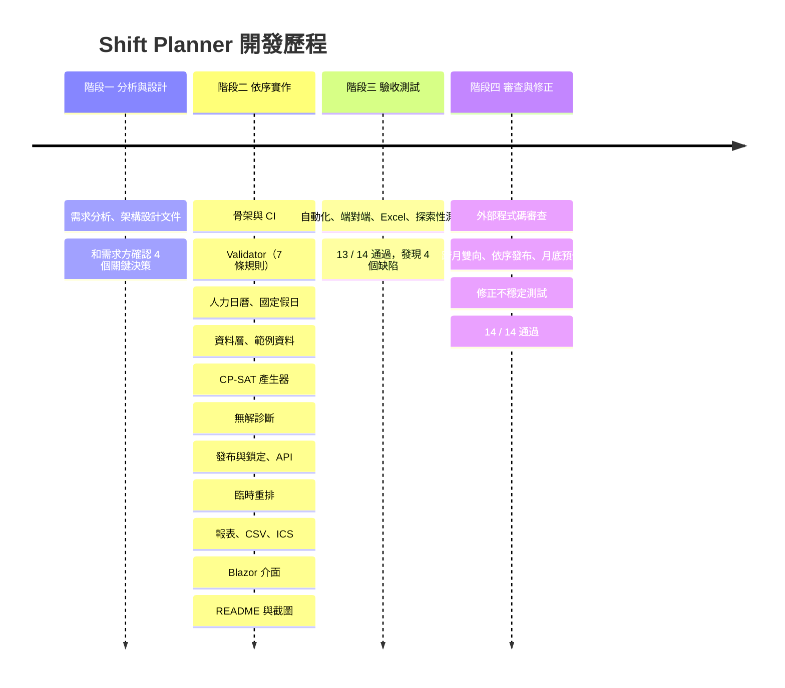

# 第 11 章　開發歷程回顧與延伸練習

> 本章目標：從整個專案的 git 歷史回顧「一個中型系統是怎麼一步一步長出來的」，整理可以帶到其他專案的經驗，並提供分級的延伸專題。

---

## 11.1 開發歷程

撰寫本教學文件之前，整個專案共 27 個 commit，可分為四個階段。每個 commit 都能編譯、所有測試都通過，commit 訊息說明「**為什麼**」這樣改。



### 階段一：先分析，再寫程式

開發前先寫了 `docs/architecture.md`，包含：

- 領域名詞、每條規則的精確定義與邊界
- 專案分層、資料模型、API 草案
- 每條驗收標準對應的測試設計
- 4 個需要需求方決定的問題（UI 框架、求解器、缺口是否擋發布、.NET 版本）

**為什麼值得**：開發中幾乎沒有「寫到一半才發現規則不清楚」的情況。規則的邊界（例如月底不完整的週）在設計時就定好了。

### 階段二：由內而外，每步都可驗證

實作順序是**由內層往外層**：

```
Core（Validator）→ 日曆 → 資料層 → 產生器 → 無解診斷 → 發布 → 重排 → 匯出 → UI
```

先做 Validator 而不是產生器，是因為**有了 Validator，才能檢查產生器的結果**。產生器完成的那一刻，就能立刻用 Validator 驗證它（第 3 章的交叉驗證）。

UI 放在最後：此時所有業務邏輯都有測試，UI 只是把它們接起來。UI 開發時發現的問題，都只是顯示層級的（例如選取框蓋住違規紅框）。

### 階段三：驗收測試找到自動化測試沒抓到的問題

98 個自動化測試全部通過，但驗收測試仍然找到 4 個缺陷（第 10 章 10.7 節）。其中最嚴重的跨月問題，是**探索性測試**刻意嘗試「12 月已發布後重排 11 月底」才發現的。

### 階段四：程式碼審查與修正

外部審查指出兩個**結構性**問題（第 8 章），都是「功能測試全部通過，但設計有缺口」的類型。修正時又踩到兩次不穩定測試（第 10 章），最後在多平台、多次執行下穩定通過。

---

## 11.2 可以帶走的經驗

### 系統分析

1. **規則要有可計算的定義**。「休息 11 小時」定義成時間區間的差，而不是列舉班別組合。
2. **主動找邊界**：期間的切分點（跨日、跨週、跨月）幾乎一定藏著問題。
3. **把決策寫下來**，附上選項與理由。

### 設計

4. **讓錯誤在對的層級被處理**：草稿階段的違規要「被看見」，發布時才要「被阻止」。
5. **同一件事只寫一次**：時間換算只在 `ShiftCatalog`；資料載入只在 `PlanningDataLoader`；畫面和 CSV 共用 `Cells`。
6. **兩套獨立實作互相檢查**（產生器 vs. Validator），比單靠測試多一層保護。
7. **好的抽象讓需求變更的影響變小**：規則透過 `AssignmentsOf` 取得班次，加入後續上下文時，大部分規則不用改。

### 演算法

8. **描述問題，而不是描述解法**：限制規劃讓你專注在「什麼是合法的」。
9. **重用模型**：重排 = 同一個模型 + 凍結的上下文 + 基準差異。
10. **可解釋性要用使用者的語言**：彈性模型的「哪一格缺幾人」比 IIS 更有用。
11. **注意貪婪規則**：局部合法的選擇，可能把成本推給下一個期間。

### 測試與品質

12. **紅燈驗證的是測試本身**。
13. **非決定性演算法要測性質**；不穩定測試要找根因，並在多個環境驗證。
14. **用真實的軟體驗收**：「用 Excel 開啟」就要真的用 Excel 開啟。
15. **審查有價值**：自己寫的程式碼，最難看出自己的假設。

---

## 11.3 延伸專題

依難度分級，每個專題都要附上測試，並更新 README 的相關說明。

### 入門（1～4 小時）

| 題目 | 說明 | 相關章節 |
|---|---|---|
| A1 修正 `ApplyRevision` 的原子性 | 先寫會失敗的測試，再改成「先檢查全部、再修改」 | 2 |
| A2 每月夜班上限規則 | 新增 `MonthlyNightLimitRule`，同步修改產生器 | 4、5 |
| A3 CSV injection 防護 | 以 `=`、`+`、`-`、`@` 開頭的欄位加上單引號 | 9 |
| A4 ICS 的 UID 改為「員工 + 日期」 | 同一天換班別時更新既有事件 | 9 |

### 進階（1～2 天）

| 題目 | 說明 | 相關章節 |
|---|---|---|
| B1 勞基法「任意 7 日」版本 | 每週休息日改成滑動視窗，並比較兩種定義的結果差異 | 1、4、5 |
| B2 全職工時目標 | 讓全職員工的工時盡量接近 40 小時，並調整權重 | 5 |
| B3 字典序最佳化 | 分階段求解，比較結果與耗時 | 5 |
| B4 員工自助登記偏好 | 加入員工角色（需要登入與權限），只能看自己的班、登記自己的偏好 | 3 |
| B5 月份總覽頁 | 顯示每月狀態與跨月檢查是否完成 | 8 |

### 挑戰（一週以上）

| 題目 | 說明 | 相關章節 |
|---|---|---|
| C1 多部門、數百人規模 | 量測求解時間，嘗試依部門拆分、調整搜尋策略、增量驗證 | 4、5 |
| C2 換班交易市場 | 員工提出換班申請，系統自動檢查合法性，主管一鍵核准 | 4、7 |
| C3 預測式人力需求 | 依歷史話務量預測每小時需求，改為以小時為單位的班表 | 1、5 |
| C4 多人同時編輯 | 移除「只有一位主管」的假設，處理並行編輯與衝突 | 3、7 |

---

## 11.4 給教師的建議

| 課程 | 可以這樣使用本專案 |
|---|---|
| 系統分析與設計 | 只給學生題目（`README` 的需求部分），讓他們寫出第 1 章的規則定義表，再和 `docs/architecture.md` 對照 |
| 軟體工程 | 用 git 歷史講解「小步提交、每步可驗證」；用測試報告講解驗收測試與缺陷管理 |
| 物件導向設計 | 第 2、3、4 章：值物件、聚合、策略模式、依賴方向 |
| 演算法／作業研究 | 第 5、6、7 章；讓學生先手寫貪婪演算法，再和 CP-SAT 比較，體會「無法證明無解」的意義 |
| 軟體測試 | 第 10 章；讓學生在 `RestPeriodRule` 植入錯誤（例如把 `>=` 改成 `>`），觀察哪些測試會失敗（變異測試的概念） |

---

## 結語

這個專案最值得學習的，不是 CP-SAT 或 Blazor 的用法，而是這些習慣：

- 在寫程式之前，先把規則的邊界想清楚；
- 讓每一步都可以被驗證；
- 用真實的方式驗收；
- 接受審查，並把發現的問題寫成測試，讓它不再回來。

工具會過時，這些習慣不會。
